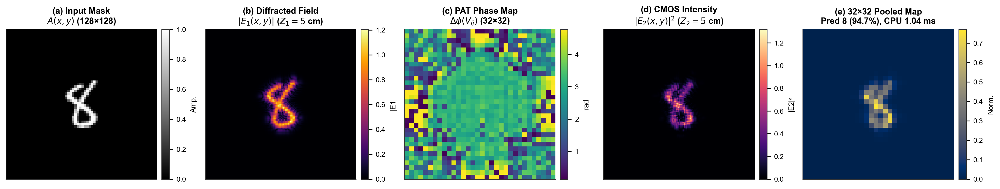
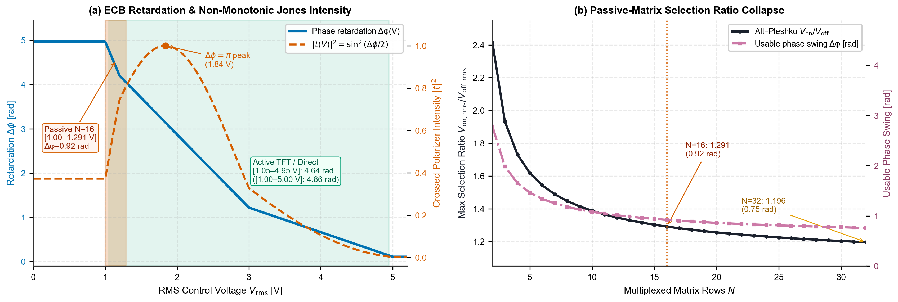
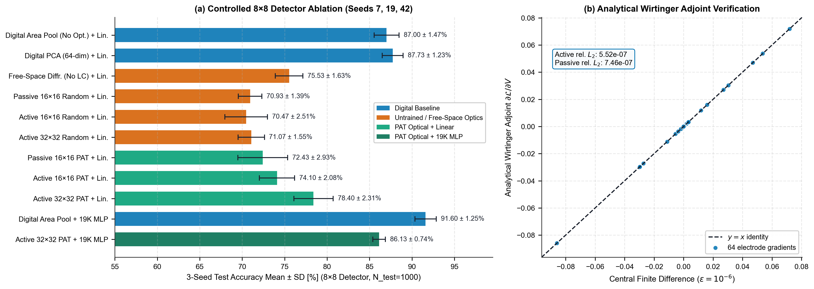
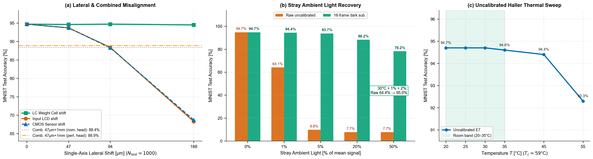
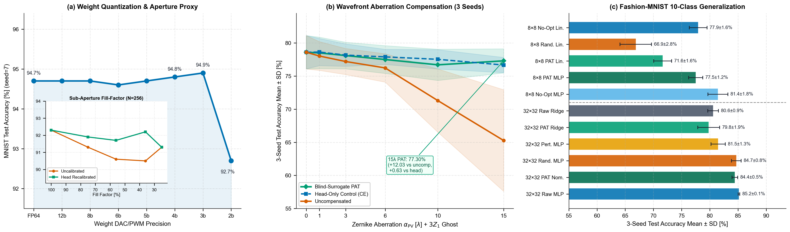

# ZERRE (Model H): Wave-Optics Design, Physical Synthesis, and Physics-Aware Training of a Common-Path Optoelectronic Processor

**Hamza Solak**  
Independent Researcher, Türkiye  
E-mail: eng.hamzasolak@gmail.com | ORCID: [0009-0004-7541-9620](https://orcid.org/0009-0004-7541-9620)

---

## Abstract

Programmable optical neural processors typically rely on expensive spatial light modulators and vibration-sensitive dual-arm interferometers. This numerical design and wave-optics simulation study presents ZERRE (Model H), an open-source common-path optoelectronic architecture built around commodity monochrome masked stereolithography (mSLA) liquid-crystal displays. Based on measured nematic attenuation, volumetric reservoirs were rejected due to thermal Rayleigh–Gans scattering (15–40 dB/cm), and passive-matrix ITO addressing was shown via the Alt–Pleshko bound to compress usable E7 phase retardation from 4.86 rad (1.00–5.00 V) to 0.921 rad across 16 rows. An analytical Wirtinger-adjoint operator through scalar Angular Spectrum propagation and coupled Jones modulation (relative finite-difference error $5.52 \times 10^{-7}$) enables Physics-Aware Training (PAT) under unmodeled hardware perturbations. Across three random seeds ($N_{\text{test}}=1000$) in an $8 \times 8$ detector-bottlenecked regime with every readout head matched to an identical cross-entropy/Adam protocol, PAT lifts linear MNIST accuracy from 71.07% to 78.40% (+7.33 points over matched random optics) yet trails direct digital area pooling (87.00%) by 8.60 points. With a $32 \times 32$ readout grid and hybrid multilayer perceptron, the nominal-twin upper bound reaches 94.67% on MNIST and 84.43% on Fashion-MNIST (perturbed plant: 91.07%, 81.47%), matching raw-pixel (93.93%, 85.17%) and random-optics (94.20%, 84.70%) MLPs. Blind PAT reaches 77.30% under 15-wavelength Zernike aberrations (+0.63 points over 76.67% head-only recalibration, within one combined SD) and retains 94.8% at 4-bit quantization, but trails head-only recalibration (76.80% vs. 79.13%) under structural model mismatch (perturbed LC curve, camera gamma, speckle). Estimated component cost is \$784–\$959.

**Keywords:** Angular spectrum method, diffractive neural networks, liquid-crystal modulators, optoelectronic computing, physics-aware training, Wirtinger adjoint.

---

## 1. Introduction

In modern CMOS and GPU accelerators, 60% to 90% of total inference energy is spent moving weights and activations across DRAM and interconnect hierarchies rather than performing multiply-accumulate arithmetic [1, 2]. Free-space and integrated optical computing architectures address this data-movement bottleneck in the analog domain: as an optical field propagates through structured diffractive or phase-modulating elements, spatial superposition executes dense linear transformations passively during its sub-nanosecond transit across a centimeter-scale cavity ($\sim 0.33\,\text{ns}$ across a $10\,\text{cm}$ optical path) [3–5].

Static 3D-printed diffractive deep neural networks ($\text{D}^2\text{NN}$) established passive inference at terahertz wavelengths [5], yet fixed dielectric plates cannot be reprogrammed after fabrication. Subsequent reconfigurable systems introduced nanophotonic Mach–Zehnder meshes [6], large-scale diffractive processing units [7], integrated photonic tensor cores [8], time-wavelength interleaving [9], and hybrid optical-electronic convolutional front-ends [10]. Parallel efforts dating back to pocket liquid-crystal televisions [11] and recent spatial-light vector-matrix multipliers [12] demonstrated that display hardware can serve as programmable optical weights.

Three engineering barriers still hinder accessible experimental adoption: laboratory liquid-crystal-on-silicon (LCOS) spatial light modulators cost \$8,000–\$40,000 per plane; dual-arm interferometers experience destructive fade under nanometer path shifts ($\lambda/4 \approx 133\,\text{nm}$ at $532\,\text{nm}$) [6]; and weights trained on idealized numerical models lose accuracy when deployed onto misaligned optical hardware, an effect worsened when designers overlook RMS voltage clamping in passive-matrix liquid-crystal cells.

This article presents a numerical design and wave-optics simulation study of **ZERRE (Model H)**, an open-source common-path optoelectronic processor architecture and digital twin; no physical benchtop prototype has been constructed or optically measured at this stage. Starting from volumetric bulk scattering bounds in nematic liquid crystals [13], eight candidate topologies (Models A–H) are winnowed down to a planar $7\,\mu\text{m}$ thin-cell stack built from commodity monochrome mSLA 2K displays (\$40–\$60 each). Applying the Alt–Pleshko multiplexing theorem [14] shows that $16 \times 16$ passive-matrix scanning ($1/5$ voltage bias) restricts the RMS selection ratio to $1.290994$ and shrinks usable E7 phase retardation by $5.28\times$ ($4.86\,\text{rad}$ to $0.921\,\text{rad}$), motivating an active-matrix TFT-LCD or direct AC-PWM weight plane. Finally, deriving exact analytical Wirtinger-adjoint gradients through Angular Spectrum propagation enables Physics-Aware Training (PAT) [15, 16] on a perturbed physical plant simulator, audited across three random seeds on MNIST and Fashion-MNIST alongside mechanical, thermal, stray-light, bit-quantization, sub-aperture fill-factor, and Zernike aberration stress tests.

> **Figure 1.** Scalar wave-optics forward propagation of a handwritten MNIST digit ("8") through the simulated ZERRE Model H pipeline ($N=128^2$, $\Delta x=47\,\mu\text{m}$): **(a)** input amplitude mask $A(x,y)$ on the monochrome mSLA panel; **(b)** diffracted field amplitude $|E_1(x,y)|$ at the LC weight plane after $Z_1=5\,\text{cm}$ Angular Spectrum propagation; **(c)** PAT-trained $32 \times 32$ active LC phase retardation map $\Delta\phi(V_{ij})$ [rad]; **(d)** CMOS sensor intensity $|E_2(x,y)|^2$ after crossed-analyzer projection and $Z_2=5\,\text{cm}$ propagation; **(e)** $32 \times 32$ pooled optical feature map (predicted Class 8 at 94.7% confidence; $1.04\,\text{ms}$ median CPU simulation time on $N=128^2$).

---

## 2. Architectural Synthesis and Physical Constraints

### 2.1 Bulk Nematic Scattering: Spherical Reservoir vs. Thin Planar Cell

Among eight evaluated conceptual topologies (Models A–H), four volumetric nematic-reservoir designs (32-electrode Fibonacci sphere Model A, hemispherical hybrid bowl Model C, photodiode-addressed sphere Model F, and spherical ITO matrix Model G) investigated filling centimeter-scale borosilicate vessels ($\varnothing 100\,\text{mm}$) with Merck E7 to induce three-dimensional optical mixing. In nematic mesophases, however, thermal fluctuations of the molecular director generate Rayleigh–Gans scattering roughly two orders of magnitude stronger than intrinsic absorption, producing attenuation coefficients of $\alpha_{\text{scat}} \approx 15\text{–}40\,\text{dB/cm}$ across the visible spectrum [13]. Across an $L = 10\,\text{cm}$ optical path inside a spherical cell, ballistic attenuation reaches $150\text{–}400\,\text{dB}$, extinguishing wavefront coherence into diffuse photon transport and rendering the director field unstable under mechanical sloshing.

By contrast, confining E7 inside a planar gap of $d \le 7\,\mu\text{m}$ reduces bulk scattering loss to $0.003\text{–}0.03\,\text{dB}$ while capillary forces immobilize the fluid layer. At $\lambda = 532\,\text{nm}$, a $7\,\mu\text{m}$ layer of pure E7 ($\Delta n = 0.225$) imparts an unbiased phase retardation of $18.60\,\text{rad}$ ($\approx 5.92\pi$), spanning multiple interference orders. A monotonic, single-order working window of

$$
\Delta\phi_{\max} = \frac{2\pi}{\lambda}\,\Delta n_{\text{eff}}\, d \approx 4.97\,\text{rad} \; (\approx 1.58\pi) \tag{1}
$$

is realized either with fluorinated nematic mixtures native to mSLA TFT panels ($\Delta n_{\text{eff}} \approx 0.060$ at $d = 7\,\mu\text{m}$), a thinner $d = 1.87\,\mu\text{m}$ pure E7 gap, or a $7\,\mu\text{m}$ E7 cell biased above $2.2\,\text{V}$ RMS. Among the remaining planar thin-cell candidates, a passive $16 \times 16$ ITO plate (Model B) encounters the multiplexing limit analyzed in Section 2.3, a single 7-layer stack (Model D) defines the $7\,\mu\text{m}$ cell cross-section, and a 3-layer cascaded stack (Model E) compounds insertion loss and alignment tolerances, leaving the single-weight-plane common-path stack (Model H) as the minimal realizable synthesis. Any future exploratory test of thick-cell scattering is gated by a low-cost $1\,\text{cm}$ glass cuvette transmission check prior to spherical fabrication.

### 2.2 Input Encoding via Commodity mSLA Monochrome LCDs

Mass-produced monochrome LCD panels built for masked stereolithography (mSLA) 3D printers offer a practical alternative to research LCOS modulators. Typical units offer $1440 \times 2560$ pixels on a $5.5\,\text{inch}$ panel ($\sim 47\,\mu\text{m}$ pitch, with $1620 \times 2560$ resolution on $\sim 6.1\,\text{inch}$ displays), omit absorptive RGB color filters, ship without a backlight as bare transmissive valves, and interface with standard HDMI-to-MIPI driver boards at $60\,\text{Hz}$ (8-bit grayscale) for \$40–\$60. Although thin-film transistor (TFT) bus lines restrict clear aperture transmittance to roughly 4%–8%, a $100\,\text{mW}$ $532\,\text{nm}$ diode-pumped solid-state (DPSS) laser paired with millisecond camera exposure easily compensates for this loss, while the $16.7\,\text{ms}$ frame refresh outpaces the $\sim 50\,\text{ms}$ viscoelastic relaxation time of E7.

> **Figure 2.** Passive-matrix multiplexing limit in nematic LC weight layers: **(a)** ECB phase retardation $\Delta\phi(V_{\text{rms}})$ (blue, left axis) and non-monotonic crossed-polarizer intensity transmittance $|t(V)|^2 = \sin^2(\Delta\phi/2)$ peaking at $\Delta\phi = \pi$ near $1.84\,\text{V}$ (dashed vermilion, right axis). Red shading marks the $[1.00\,\text{V},\, 1.291\,\text{V}]$ RMS window ($0.921\,\text{rad}$ swing) enforced by $16 \times 16$ passive scanning versus the $4.64\,\text{rad}$ active PAT window over $[1.05, 4.95]\,\text{V}$ ($4.86\,\text{rad}$ over $[1.00, 5.00]\,\text{V}$, green). **(b)** Alt–Pleshko maximum RMS selection ratio and usable phase swing as multiplexed row count $N$ increases from 2 to 32.

### 2.3 The Alt–Pleshko RMS Bottleneck in Passive Matrices

Addressing an $N \times N$ ITO grid using $2N$ row-and-column channels via time multiplexing (for instance, a $1/5$ voltage bias scheme for $N=16$) appears economical at first glance. Because the electro-optic dielectric torque in a nematic LC scales quadratically with electric field ($\propto E^2$) and integrates over a $\sim 50\,\text{ms}$ response time, each cell reacts to the root-mean-square voltage over the entire scan period rather than instantaneous row pulses:

$$
V_{\text{rms}}(i,j) = \sqrt{\frac{1}{N}\left(V_{\text{sel}} + U_{ij}V_{\text{data}}\right)^2 + \frac{1}{N}\sum_{r\neq i}\left(U_{rj}V_{\text{data}}\right)^2}, \tag{2}
$$

where $U_{rj} \in [-1, +1]$ denotes normalized column weights. Under optimal drive ratio $V_{\text{sel}}/V_{\text{data}} = \sqrt{N}$ ($=4$ for $N=16$), the Alt–Pleshko theorem [14] bounds the maximum RMS selection ratio to

$$
\frac{V_{\text{on,rms}}}{V_{\text{off,rms}}} \le \sqrt{\frac{\sqrt{N}+1}{\sqrt{N}-1}}. \tag{3}
$$

For $N=16$ multiplexed rows, this ceiling equals $\sqrt{5/3} \approx 1.290994$ (dropping further to $1.195606$ at $N=32$). Holding unselected elements near the $1.00\,\text{V}$ Freedericksz threshold caps selected pixels at $1.291\,\text{V}$ RMS, reducing usable E7 phase modulation from $4.86\,\text{rad}$ down to $0.921\,\text{rad}$ ($5.28\times$ loss, **Figure 2a**) while introducing vertical column crosstalk through the summation in Eq. (2). Model H therefore replaces passive row scanning in the weight plane with either direct AC-coupled PWM channels or a second commodity active-matrix TFT mSLA panel, whose pixel-level storage capacitors eliminate column crosstalk.

---

## 3. Wave-Optics Model and Physics-Aware Training

### 3.1 Angular Spectrum Propagation and Coupled Jones Modulation

Linearly polarized ($0^\circ$) $532\,\text{nm}$ light modulated in amplitude by the input mSLA panel forms $E_0(x,y) = A(x,y)$ and propagates across free space $Z_1 = 5\,\text{cm}$ via the non-paraxial scalar Angular Spectrum Method (ASM) [17]:

$$
E_1 = \mathcal{P}_{Z_1}\{E_0\} = \mathcal{F}^{-1}\!\left\{\mathcal{F}\{E_0\} \odot H(f_x, f_y; Z_1)\right\}, \tag{4}
$$

$$
H(f_x, f_y; z) = \exp\!\left(i\frac{2\pi}{\lambda}z\sqrt{1 - \lambda^2 f_x^2 - \lambda^2 f_y^2}\right) \cdot \mathbb{I}_{f_x^2+f_y^2 < \lambda^{-2}}, \tag{5}
$$

where evanescent spatial frequencies are truncated. At the weight plane, our analytical model treats each pixel as a parallel-aligned electrically controlled birefringence (ECB) retarder oriented at $45^\circ$ between crossed polarizers ($0^\circ/90^\circ$). Up to an overall global phase, its scalar Jones transmittance is

$$
t(V_{ij}) = \sin\!\left(\frac{\Delta\phi(V_{ij})}{2}\right) \exp\!\left(i\frac{\Delta\phi(V_{ij})}{2}\right), \tag{6}
$$

producing $E_2 = \mathcal{P}_{Z_2}\{E_1 \odot M(\mathbf{V})\}$ across $Z_2 = 5\,\text{cm}$ and square-law sensor intensity $I_{\text{CMOS}} = |E_2|^2$, which is block-averaged over a centered $K \times K$ detector grid into $\mathbf{f} \in \mathbb{R}^{K^2}$ (**Figure 1**). Notice that $\Delta\phi(V)$ follows a piecewise-linear electro-optic curve falling monotonically from $4.97\,\text{rad}$ at $1.00\,\text{V}$ to $0.11\,\text{rad}$ at $5.00\,\text{V}$ ($4.86\,\text{rad}$ full span; $4.64\,\text{rad}$ within the PAT active bounds $[1.05, 4.95]\,\text{V}$), whereas the intensity factor $|t(V)|^2 = \sin^2(\Delta\phi/2)$ is non-monotonic and peaks at $\Delta\phi = \pi$ (**Figure 2a**). Here Eq. (6) acts as a closed-form coupled amplitude–phase surrogate for commercial twisted-nematic (TN) mSLA displays [18]; physical assembly using a TN weight panel requires aligning its polarizers appropriately and empirically calibrating its voltage–Jones curve. Forward and adjoint FFT propagations during PAT execute in `complex64` precision, whereas non-PAT analytical sweeps and evaluation paths run in `complex128`.

With pixel pitch $\Delta x = 47\,\mu\text{m}$, the critical ASM sampling dimension is $N_{\text{crit}} = \lambda Z_1 / \Delta x^2 \approx 12.0$ pixels, so an $N=128$ (or $256$) grid satisfies Nyquist sampling by more than an order of magnitude. Maximum diffraction walk-off across $Z_1$ is $Z_1\lambda/(2\Delta x) = 0.283\,\text{mm}$, well within the zero-padded spatial guard bands of $1.69\,\text{mm}$ around the $2.63\,\text{mm}$ input digit and $0.75\,\text{mm}$ around the $4.51\,\text{mm}$ active weight array at $N=128$ ($2.73\,\text{mm}$ and $1.50\,\text{mm}$ at $N=256$), suppressing circular wrap-around aliasing.

### 3.2 Analytical Wirtinger Adjoint Backpropagation

To differentiate a scalar task loss $\mathcal{L}$ with respect to the control voltages $\mathbf{V}$ without finite-difference evaluations across hundreds of electrodes, the complex Wirtinger error field at the sensor plane for $I = E_2 E_2^*$ is written as

$$
G_{\text{cam}} = 2 \left(\frac{\partial \mathcal{L}}{\partial I}\right) \odot E_2. \tag{7}
$$

Under the discrete real inner product $\langle u, v \rangle = \operatorname{Re}\sum u^* v$, the exact Hermitian adjoint of ASM propagation is backward propagation by $-Z_2$:

$$
G_{\text{mask}} = \mathcal{P}_{Z_2}^{\dagger}\{G_{\text{cam}}\} = \mathcal{F}^{-1}\!\left\{\mathcal{F}\{G_{\text{cam}}\} \odot H^*(f_x, f_y; Z_2)\right\}. \tag{8}
$$

Integrating $G_{t,ij} = \sum_{(u,v)\in\Omega_{ij}} E_1^*(u,v)\, G_{\text{mask}}(u,v)$ over each electrode macro-pixel $\Omega_{ij}$ and applying $dt/d\phi = \frac{1}{2}e^{i\phi}$ yields the exact closed-form voltage gradient in one inverse-and-forward FFT pair:

$$
\frac{\partial \mathcal{L}}{\partial V_{ij}} = \operatorname{Re}\!\left\{G_{t,ij}^* \cdot \frac{1}{2}e^{i\Delta\phi(V_{ij})}\right\} \cdot \left.\frac{d\Delta\phi}{dV}\right|_{V_{ij}}. \tag{9}
$$

Against central finite differences ($\varepsilon = 10^{-6}$), Eq. (9) agrees to a relative $L_2$ error of $5.52 \times 10^{-7}$ in active mode and $7.46 \times 10^{-7}$ under the passive Alt–Pleshko RMS chain rule (**Figure 3b**).

> **Figure 3.** **(a)** Leakage-free 3-seed MNIST test accuracy (mean $\pm$ 1 SD, $N_{\text{test}}=1000$) across all 11 matched configurations in the $8 \times 8$ detector-bottlenecked regime on a perturbed physical plant simulator. PAT-trained $32 \times 32$ active optics improves linear classification by $+7.33$ points over matched random optics (78.40% vs. 71.07%) while remaining 8.60 points below direct digital area pooling (87.00%). **(b)** Parameter-wise agreement between analytical Wirtinger adjoint gradients and central finite differences ($\varepsilon=10^{-6}$).

### 3.3 Physics-Aware Training and Dark-Frame Stabilization

Because physical optical builds exhibit uncalibrated mounting offsets, temperature shifts, and readout noise, our Physics-Aware Training (PAT) loop [15] evaluates forward sensor features $\mathbf{f}_{\text{phys}}$ using a perturbed physical plant simulator while computing optical backward steps via Eqs. (7)–(9) on the uncalibrated nominal digital twin (retaining Simultaneous Perturbation Stochastic Approximation, SPSA [19], as a gradient-free fallback). Under ambient stray light, near-zero-variance peripheral CMOS pixels can blow up by orders of magnitude during z-score normalization. We suppress this instability by subtracting a 16-frame noisy dark background estimate and enforcing a training-only standard-deviation floor:

$$
\tilde{\mathbf{f}} = \frac{(\mathbf{f}_{\text{on}} - \mathbf{f}_{\text{dark}}) - \boldsymbol{\mu}_{\text{tr}}}{\max\!\left(\boldsymbol{\sigma}_{\text{tr}},\, 0.05\cdot\operatorname{mean}(\boldsymbol{\sigma}_{\text{tr}})\right)}, \tag{10}
$$

where $\boldsymbol{\mu}_{\text{tr}}$ and $\boldsymbol{\sigma}_{\text{tr}}$ are computed strictly from the training split without test-set leakage.

| Parameter | Value / Specification |
| :--- | :--- |
| Wavelength $\lambda$ / Pixel pitch $\Delta x$ | $532\,\text{nm}$ / $47\,\mu\text{m}$ |
| Axial spacings $Z_1$, $Z_2$ | $50\,\text{mm}$, $50\,\text{mm}$ ($10\,\text{cm}$ path, $0.33\,\text{ns}$) |
| Grid sizes $N$ | $128 \times 128$ ($6.02\,\text{mm}$), $256 \times 256$ ($12.03\,\text{mm}$) |
| ASM critical grid / Walk-off | $N_{\text{crit}} = 12.0\,\text{px}$ / $0.283\,\text{mm}$ |
| Zero-pad guard bands ($N=128$) | $1.69\,\text{mm}$ (input), $0.75\,\text{mm}$ (weight) |
| Active / Passive control bounds | $[1.05, 4.95]\,\text{V}$ ($4.64\,\text{rad}$) / $[-1, +1]$ ($0.921\,\text{rad}$) |
| Optimizer | Adam ($\text{lr}_{\text{opt}}=0.07\text{–}0.10$; $\text{lr}_{\text{head}}=2.5 \times 10^{-2}$ / $2.5 \times 10^{-3}$) |
| Regularization / Schedule | $10^{-4}$ $L_2$; $18$ ep. (linear head, all rows) / $40\text{–}45$ ep. (MLP, all rows); early stop |
| Perturbed plant faults | $47\,\mu\text{m}$ LCD/CMOS, $+1.2$/$-0.8\,\text{mm}$ $Z$, $29\,^\circ\text{C}$, 2% drift |
| Evaluation seeds / Test count | $\{7, 19, 42\}$ / $N_{\text{test}}=1000$ per split |

> **Table 1.** Simulation setup, optical geometry, and training hyperparameters.

---

## 4. Numerical Results and Analysis

### 4.1 Controlled 8×8 Detector Ablation on MNIST

All numerical experiments were executed in Python 3.11.9 / NumPy 2.2.3 on CPU (Intel64 Family 6 Model 170) using `complex64` propagation in PAT paths and `complex128` in non-PAT/evaluation paths under the hyperparameters summarized in **Table 1**. To isolate what programmable optical weights contribute when electronic readout bandwidth is severely constrained, we benchmarked 11 matched configurations over an $8 \times 8 = 64$ detector grid on MNIST [20] across three random seeds ($N_{\text{fit}} = 2640$, $N_{\text{val}} = 360$, $N_{\text{test}} = 1000$). The plant simulator included $47\,\mu\text{m}$ lateral LCD and sensor shifts, $+1.2\,\text{mm}/-0.8\,\text{mm}$ axial spacing errors, a $29\,^\circ\text{C}$ Haller thermal birefringence drift [21, 22], 2% laser gain drift, and Gaussian readout noise, all unknown to the surrogate twin (**Table 2**, **Figure 3a**). Critically, every linear-readout row—including the random-optics, free-space, and digital controls—is scored with the identical cross-entropy/Adam linear head used inside PAT (same fit/validation split, epoch count, batch size, learning rate, and best-validation-weights early-stopping rule); closed-form ridge accuracies are reported only as a secondary diagnostic column. Random-optics controls are trained on noisy plant features and evaluated on noise-free features, exactly matching the PAT protocol.

| # | Architecture / Configuration | Opt. W | Dig. W | Test (%) | Ridge (diag.) |
| :-: | :--- | --: | --: | --: | --: |
| 1 | Digital Area Pooling ($8 \times 8$) + Linear | 0 | 650 | 87.00 ± 1.47 | 81.27 ± 0.55 |
| 2 | Digital PCA Basis ($64$-dim) + Linear | 0 | 650ᵃ | 87.73 ± 1.23 | 83.97 ± 1.29 |
| 3 | Free-Space Diffraction Only (No LC) | 0 | 650 | 75.53 ± 1.63 | 68.57 ± 0.95 |
| 4 | Passive $16 \times 16$ Random + Linear | 256 | 650 | 70.93 ± 1.39 | 69.00 ± 0.40 |
| 5 | Active $16 \times 16$ Random + Linear | 256 | 650 | 70.47 ± 2.51 | 67.43 ± 0.85 |
| 6 | Active $32 \times 32$ Random + Linear | 1,024 | 650 | 71.07 ± 1.55 | 67.77 ± 0.40 |
| 7 | Passive $16 \times 16$ + PAT + Linear | 256 | 650 | 72.43 ± 2.93 | 69.50 ± 0.46 |
| 8 | Active $16 \times 16$ + PAT + Linear | 256 | 650 | 74.10 ± 2.08 | 69.97 ± 0.64 |
| **9** | **Active $32 \times 32$ + PAT + Linear** | **1,024** | **650** | **78.40 ± 2.31** | 73.70 ± 0.75 |
| 10 | Digital Area Pooling ($8 \times 8$) + MLP | 0 | 19,210 | 91.60 ± 1.25 | — |
| **11** | **Active $32 \times 32$ + PAT + MLP** | **1,024** | **19,210** | **86.13 ± 0.74** | — |

ᵃExcludes the $784 \times 64$ linear PCA projection matrix fit on training data.

> **Table 2.** Controlled MNIST ablation on perturbed plant ($8 \times 8$ detector, 3 seeds, $N_{\text{test}}=1000$); the "Test" column reports the matched CE-Adam linear head and "Ridge" is the closed-form diagnostic comparison.

Two clear trends emerge from **Table 2**. First, unoptimized diffraction degrades accuracy sharply relative to direct imaging onto an $8 \times 8$ pixel sensor (random optics 70.47%–71.07% vs. 87.00%) because free-space divergence spreads localized strokes across coarse pixels. Optimizing the $32 \times 32$ active LC weights with PAT recovers $+7.33$ percentage points over matched $32 \times 32$ random optics (71.07% → 78.40%) and $+2.87$ points over bare free-space propagation (75.53%). By contrast, at $16 \times 16$ optical resolution, passive PAT (72.43 ± 2.93%) is within one standard deviation of passive random optics (70.93 ± 1.39%), while active PAT (74.10 ± 2.08%) only marginally exceeds its random counterpart (70.47 ± 2.51%), because the $8 \times 8$ readout remains bottlenecked by detector rank rather than phase stroke. Second, a single programmable diffractive layer operating on positive square-law intensity still lags behind direct electronic $8 \times 8$ area pooling (78.40% vs. 87.00%, and 86.13% vs. 91.60% with a 19K-parameter MLP), while a data-driven linear PCA-64 projection sets the unconstrained linear ceiling at 87.73 ± 1.23%. Single-plane optics learns a task-aligned spatial kernel relative to random wave mixing, but does not outcompute noiseless digital spatial pooling by itself.

### 4.2 Full-Scale 32×32 Hybrid Classification on MNIST and Fashion-MNIST

Scaling the CMOS detector grid to $32 \times 32$ (1,024 pooled features) reveals how optical and electronic capacities interact across both MNIST [20] and 10-class Fashion-MNIST [23] (**Table 3**). With a regularized Ridge linear readout at $N_{\text{train}}=6000$ (regularization $\alpha$ selected on a validation split), a fixed random $32 \times 32$ optical mask is statistically equivalent to raw $28 \times 28$ digital pixels on MNIST (85.97 ± 2.05% vs. 85.43 ± 1.36%), while PAT-trained $32 \times 32$ Ridge on Fashion-MNIST trails raw digital pixels at the margin (79.80 ± 1.93% vs. 80.57 ± 0.95%).

| Configuration | Opt. W | Dig. W | MNIST (%) | F-MNIST (%) |
| :--- | --: | --: | --: | --: |
| Raw $28 \times 28$ Digital Ridge ($N=6\text{k}$) | 0 | 7,850 | 85.43 ± 1.36 | 80.57 ± 0.95 |
| Opt. $16 \times 16$, 256f Ridge ($N=2.5\text{k}$) | 256 | 2,570 | 81.90 ± 1.08 | — |
| Opt. $16 \times 16$, 1024f Ridge ($N=2.5\text{k}$) | 256 | 10,250 | 84.13 ± 1.22 | — |
| Opt. $32 \times 32$ Rand., 1024f Ridge ($N=6\text{k}$) | 1,024 | 10,250 | 85.97 ± 2.05 | — |
| Opt. $32 \times 32$ PAT, 1024f Ridge ($N=6\text{k}$) | 1,024 | 10,250 | — | 79.80 ± 1.93 |
| Raw $28 \times 28$ Digital MLP ($N=6\text{k}$) | 0 | 203,530 | 93.93 ± 0.99 | 85.17 ± 0.15 |
| $32 \times 32$ Random Optics + MLP | 1,024 | 264,970 | 94.20 ± 0.95 | 84.70 ± 0.85 |
| $32 \times 32$ PAT + MLP (Perturbed) | 1,024 | 264,970 | 91.07 ± 1.90 | 81.47 ± 1.27 |
| $32 \times 32$ PAT + MLP (Nominal twin, upper bound) | 1,024 | 264,970 | 94.67 ± 0.55 | 84.43 ± 0.51 |

> **Table 3.** Full-scale $32 \times 32$ hybrid & digital baselines (3 seeds, $N_{\text{test}}=1000$).

Once a $1024 \to 256 \to 10$ ReLU MLP (264,970 digital weights) is attached, electronic capacity dominates classification accuracy: PAT with its head retrained on the unperturbed nominal twin (94.67% MNIST, 84.43% Fashion-MNIST; an upper bound rather than a calibrated physical result), random fixed optics with an MLP (94.20%, 84.70%), and raw digital pixels with an MLP (93.93%, 85.17%) all converge within $\sim 0.5$ percentage points. Under the uncompensated perturbed plant simulator, PAT MLP scores 91.07 ± 1.90% on MNIST and 81.47 ± 1.27% on Fashion-MNIST. Conversely, in the detector-constrained $8 \times 8$ Fashion-MNIST regime (**Figure 5c**), PAT linear classification yields $+4.76$ points over matched random optics (71.63 ± 1.59% vs. 66.87 ± 2.80%), reaching 77.50 ± 1.25% with a 19K MLP versus 77.93 ± 1.57% (linear) and 81.43 ± 1.78% (MLP) for direct $8 \times 8$ digital pooling; thus the optical layer still trails even the linear digital baseline in the constrained regime.

> **Figure 4.** Mechanical and environmental stress tests ($N_{\text{test}}=1000$, seed 7, nominal base 94.7%): **(a)** single-axis lateral shifts of the LC weight cell (94.7% → 94.5% at $188\,\mu\text{m}$), input LCD (94.7% → 68.3%), and CMOS sensor (94.7% → 68.7%), alongside combined $47\,\mu\text{m} + 1\,\text{mm}$ misalignment (88.4% nominal head; 88.9% perturbed-trained head from 89.0% base); **(b)** stray ambient light collapse versus 16-frame noisy dark-frame subtraction with training-only standard-deviation floor, plus $30\,^\circ\text{C} + 1\% + 2\%$ recovery (64.4% → 95.0%); **(c)** uncalibrated Haller thermal sweep ($20\text{–}55\,^\circ\text{C}$, $T_c=59\,^\circ\text{C}$).

### 4.3 Mechanical Alignment, Thermal Drift, and Ambient Light Resilience

In a common-path cavity without an external reference arm, axial intensity tolerance scales with the Talbot distance $z_T = 2\Delta x^2/\lambda \approx 8.3\,\text{mm}$. Evaluated on 1,000 MNIST test digits (seed 7, nominal base 94.7%, **Figure 4a**), shifting the LC weight panel laterally up to $188\,\mu\text{m}$ incurs only 0.2 points loss (94.7% → 94.5%) because incident optical fields are spatially smooth. Input LCD and CMOS sensor shifts exhibit steeper sensitivity beyond $47\,\mu\text{m}$ (93.7% at $47\,\mu\text{m}$, 68.3% and 68.7% at $188\,\mu\text{m}$), whereas axial shifts $\Delta Z_1 \in [0, 8\,\text{mm}]$ remain within 94.3%–94.7%. Applying $47\,\mu\text{m}$ lateral shifts on all planes plus $+1\,\text{mm}$ axial offset lowers nominal-head accuracy to 88.4% ($-6.3$ points), while a head trained directly under plant perturbations holds 88.9% relative to its 89.0% baseline ($-0.1$ points).

Modeling E7 birefringence via the Haller power law [21, 22]:

$$
\frac{\Delta n(T)}{\Delta n(25\,^\circ\text{C})} = \left(\frac{T_c - T}{T_c - 25}\right)^{\!\beta}, \qquad T_c = 59\,^\circ\text{C},\; \beta = 0.22, \tag{11}
$$

uncalibrated classification stays between 94.4% and 94.7% across $20\text{–}45\,^\circ\text{C}$, dipping to 92.3% at $55\,^\circ\text{C}$ near the clearing point (**Figure 4c**). Without background subtraction, stray ambient light totaling 1% or 5% of mean signal drops accuracy to 64.1% and 9.8%. Subtracting a 16-frame noisy dark-frame estimate alongside Eq. (10) maintains 94.4% at 1%, 93.7% at 5%, 88.2% at 20%, and 78.2% at 50% ambient leakage, and restores a combined $30\,^\circ\text{C}$ + 1% leakage + 2% laser drift fault from 64.4% to 95.0%. Laser power variations across $\pm 10\%$ stay within 94.2%–94.9%.

> **Figure 5.** Hardware-realism and generalization benchmarks ($N_{\text{test}}=1000$): **(a)** post-training weight quantization with an 8-bit HDMI input panel (flat at 94.6%–94.9% down to 4 bits, 92.7% at 2 bits) and macro-pixel sub-aperture fill-factor inset (uncalibrated 92.3% → 91.3% vs. head-recalibrated 92.3% → 91.3% at 25% fill); **(b)** 3-seed Zernike wavefront aberrations ($0\text{–}15\lambda$ PV + $3Z_1$ ghost) comparing uncompensated weights (65.27 ± 7.67% at $15\lambda$), matched CE head-only recalibration (76.67 ± 1.15%), and blind-surrogate PAT (77.30 ± 1.82%); **(c)** 3-seed 10-class Fashion-MNIST comparison across $8 \times 8$ and $32 \times 32$ regimes.

### 4.4 Bit Quantization, Aperture Proxy, and Wavefront Aberrations

Three further simulation checks test assumptions prior to benchtop fabrication (**Figure 5a–b**). Under post-training quantization of an 8-bit HDMI input coupled with $b$-bit LC control voltages (seed 7), accuracy remains constant at 94.6%–94.9% down to 4 bits (16 voltage levels), slipping modestly to 92.7% at 2 bits. Simulating a macro-pixel sub-aperture fill-factor proxy from 100% down to 25% ($N=256$ fine grid, leakage-free gain scaling) reduces uncalibrated accuracy slightly from 92.3% to 91.3%, while recalibrating only the digital readout head keeps performance within the same range at 91.3%.

Introducing fifth-order Zernike substrate wavefront aberrations ($0\text{–}15\lambda$ peak-to-valley across defocus, astigmatism, coma, spherical aberration, and float-glass ripple) plus a $3Z_1$ Fabry–Pérot ghost (0.04 Fresnel field amplitude) reveals a nuanced comparison when all conditions share identical cross-entropy Adam readout optimization (**Figure 5b**). Across $1\lambda$ to $10\lambda$, recalibrating the linear head with frozen optical weights recovers nearly all uncompensated loss (78.03% → 78.63% at $1\lambda$; 71.30% → 77.53% at $10\lambda$), performing comparably to blind-surrogate PAT (78.50% and 76.70%). At severe $15\lambda$ distortion, uncompensated deployment falls to 65.27 ± 7.67%, head recalibration alone reaches 76.67 ± 1.15%, and joint optical adaptation via PAT attains 77.30 ± 1.82% (a +0.63-point advantage well within one combined standard deviation, which should be read as statistically marginal rather than a demonstrated superiority).

We additionally test a harsher regime that the parametric plant cannot express: a *structural* model mismatch in which the physical forward model carries a perturbed LC transfer curve (±10% lookup perturbation), camera gamma 0.90, and multiplicative speckle (none of which exist in the surrogate's physics). On the same $8 \times 8$ MNIST protocol, uncompensated ideal weights score 71.30 ± 1.08%, matched head-only recalibration reaches 79.13 ± 2.39%, and blind-surrogate PAT scores 76.80 ± 1.65%: PAT recovers most of the uncompensated loss but, surprisingly, is *outperformed by head-only recalibration*. This suggests that once the mismatch is structural rather than parametric, digital feature normalization absorbs the distortion more effectively than optical weight updates computed on an incorrect surrogate.

| Subsystem | Selected Hardware | Cost (USD) |
| :--- | :--- | --: |
| Optical Input | $532\,\text{nm}$ DPSS ($100\,\text{mW}$) + Expander + mSLA LCD | 150 |
| Active Weights | 2nd mSLA TFT-LCD (or ITO Cell + AC-PWM) | 90–230 |
| Readout & Host | RPi Camera 3 (IMX708, $12\,\text{MP}$) + M12 + RPi 5 | 125 |
| Optomechanics | Optical Rail, Mounts, Dark Box, $532\,\text{nm}$ Filter | 262 |
| Subtotal | Core optical and electronic components | 627–767 |
| **Total (+25%)** | **Complete benchtop prototype w/ contingency** | **784–959** |

> **Table 4.** Estimated prototype Bill of Materials (BOM).

---

## 5. Discussion, Limitations, and Hardware Roadmap

Component pricing for a modular optical rail build is itemized in **Table 4**, totaling \$627–\$767 in direct hardware or \$784–\$959 including a 25% contingency margin. Three practical timescales govern such a system and must be clearly separated: passive coherent wave propagation across $10\,\text{cm}$ of optics takes $\sim 0.33\,\text{ns}$; benchtop image-by-image throughput would be paced electronically by the $60\,\text{Hz}$ LCD/camera frame interval ($\sim 16.7\,\text{ms}$) during inference and by the $\sim 50\,\text{ms}$ nematic relaxation time during weight updates; and our uncompiled NumPy CPU ASM simulator runs at a warmed median time of $1.04\,\text{ms}$ per digit ($N=128^2$, Intel64 Family 6 Model 170 CPU, Python 3.11.9 / NumPy 2.2.3, mean $1.27\,\text{ms}$, IQR $0.63\,\text{ms}$, range $0.84\text{–}2.23\,\text{ms}$ across 50 runs).

Benchtop construction introduces several engineering requirements omitted from simplified 2D models. First, a Raspberry Pi Camera Module 3 (IMX708 sensor area $6.45 \times 3.63\,\text{mm}$) is slightly smaller along its minor axis than the $4.51\text{–}6.02\,\text{mm}$ diffracted field, necessitating a $\sim 1.6\times$ demagnifying M12 relay lens pair. Second, a $100\,\text{mW}$ $532\,\text{nm}$ DPSS laser is a Class 3B source requiring OD 4+ protective eyewear, a light-tight matte enclosure, and an infrared-cut filter to reject unabsorbed $808\,\text{nm}$ and $1064\,\text{nm}$ pump leakage. Third, commodity PCA9685 PWM driver boards emit unipolar pulses that induce electrochemical degradation across bare ITO electrodes unless buffered by an AC polarity-inversion circuit, reinforcing our selection of an active TFT display backplane.

### 5.1 Limitations

Eight principal limitations qualify these numerical findings and define the remaining engineering work before physical claims can be made. First, all classification accuracies and fault tolerances originate from wave-optics simulations; benchtop fabrication, optical alignment, and empirical detector noise measurements remain future work. Second, on $8 \times 8$ detectors with a strictly matched readout head and training protocol, PAT-trained optics beats matched random optics by $+7.33$ points yet still underperforms direct digital area pooling by $8.60$ points; when a 265K-parameter MLP head is attached at $32 \times 32$, electronic capacity compresses the gap to random optics within $\sim 0.5$ points.

Third, Eq. (6) models a parallel ECB retarder as an analytical proxy, whereas twisted-nematic mSLA panels exhibit coupled polarization rotation [18] that demands empirical lookup characterization. Fourth, our scalar simulations assume monochromatic, spatially uniform illumination, omitting DPSS laser speckle, finite coherence length, and multi-plane inter-reflections beyond the simulated 0.04 Fabry–Pérot ghost. Fifth, each $32 \times 32$ weight block groups dozens of native $47\,\mu\text{m}$ mSLA sub-pixels, so our $N=256$ sub-aperture fill-factor test serves only as a scaled proxy rather than resolving the physical panel over a multi-thousand-pixel grid. Sixth, the default perturbed plant shares the same scalar-ASM physics class as the surrogate, i.e. it probes parameter perturbations (shifts, temperature, drift, noise) rather than structural model error; we therefore added a structural-mismatch variant (perturbed LC curve, camera gamma, multiplicative speckle) and report PAT's behavior in that harsher regime in Section 4. Seventh, on physical hardware every PAT forward pass requires an LCD/camera acquisition cycle ($\sim 16.7\,\text{ms}$ per sample at 60 Hz), so an epoch over thousands of images would take minutes to hours rather than milliseconds of simulation; the PAT gains reported here demonstrate feasibility, not a practical online-training speed. Finally, all multi-seed comparisons use only three seeds and fixed train/test subsets, weights tuned for one perturbed cell do not transfer directly to another cell with distinct alignment and cell-gap variations unless paired with calibration-robust objectives such as Sharpness-Aware Training [24].

---

## 6. Conclusion

Starting from bulk nematic Rayleigh–Gans attenuation (15–40 dB/cm) and Alt–Pleshko RMS voltage limits ($5.28\times$ swing loss on 16-row passive grids), this study synthesized the planar common-path ZERRE (Model H) architecture around commodity mSLA panels within a \$784–\$959 prototype estimate. An exact Wirtinger-adjoint operator through scalar ASM diffraction enabled Physics-Aware Training under unmodeled mechanical, thermal, ambient-light, and aberration faults, raising $8 \times 8$ linear MNIST accuracy by $+7.33$ points over matched random optics (78.40%) yet remaining 8.60 points below direct digital area pooling (87.00%). At $32 \times 32$ hybrid readout the nominal-twin upper bound reaches 94.67% MNIST and 84.43% Fashion-MNIST (perturbed plant: 91.07%, 81.47%), statistically equivalent to random optics with an MLP (94.20%), so that no measurable optical computing advantage survives a strictly matched comparison; this work therefore stands as a design-feasibility study that maps the architecture's limits and concrete benchtop calibration steps rather than a demonstrated speedup or accuracy gain.

---

## Data and Code Availability

All Python wave-optics simulation scripts (`zerre_twin.py`, `zerre_pat_torch.py`), the interactive WebGL/ASM visualizer (`start_server.py`), automated physics unit tests (`tests/test_zerre_physics.py`), 3-seed benchmark outputs (`makale/scripts/paper_results.json`), and figure/manuscript generation scripts are openly released under the **MIT License** (code) and **CC BY 4.0 License** (manuscript text and figures), alongside local caching support for standard MNIST and Fashion-MNIST datasets, at [https://github.com/hamzasolak/zerre](https://github.com/hamzasolak/zerre) (release tag `v0.5.0`; Author ORCID: [0009-0004-7541-9620](https://orcid.org/0009-0004-7541-9620)).

## Funding

This work was conducted as independent research without external institutional or commercial grant funding.

## Conflicts of Interest

The author declares no conflicts of interest.

## Acknowledgments

Generative AI assistance (Gemini and Claude) was used for prose editing, LaTeX formatting, and code-audit verification across Sections I–VI; the author conceived the physical design, wrote and verified the wave-optics simulation code, executed all multi-seed benchmarks, and takes full responsibility for all scientific claims and results.

---

## References

1. M. Horowitz, "1.1 Computing's energy problem (and what we can do about it)," *IEEE International Solid-State Circuits Conference Digest of Technical Papers (ISSCC)*, San Francisco, CA, USA, pp. 10–14, 2014. DOI: [10.1109/ISSCC.2014.6757323](https://doi.org/10.1109/ISSCC.2014.6757323)
2. V. Sze, Y.-H. Chen, T.-J. Yang, and J. S. Emer, "Efficient Processing of Deep Neural Networks: A Tutorial and Survey," *Proceedings of the IEEE*, vol. 105, no. 12, pp. 2295–2329, 2017. DOI: [10.1109/JPROC.2017.2761740](https://doi.org/10.1109/JPROC.2017.2761740)
3. G. Wetzstein, A. Ozcan, S. Gigan, S. Fan, D. Englund, M. Soljačić, C. Denz, D. A. B. Miller, and D. Psaltis, "Inference in artificial intelligence with deep optics and photonics," *Nature*, vol. 588, no. 7836, pp. 39–47, 2020. DOI: [10.1038/s41586-020-2973-6](https://doi.org/10.1038/s41586-020-2973-6)
4. D. Psaltis and N. H. Farhat, "Optical information processing based on an associative-memory model of neural nets with thresholding and feedback," *Optics Letters*, vol. 10, no. 2, pp. 98–100, 1985. DOI: [10.1364/OL.10.000098](https://doi.org/10.1364/OL.10.000098)
5. X. Lin, Y. Rivenson, N. T. Yardimci, M. Veli, Y. Luo, M. Jarrahi, and A. Ozcan, "All-optical machine learning using diffractive deep neural networks," *Science*, vol. 361, no. 6406, pp. 1004–1008, 2018. DOI: [10.1126/science.aat8084](https://doi.org/10.1126/science.aat8084)
6. Y. Shen, N. C. Harris, S. Skirlo, M. Prabhu, T. Baehr-Jones, M. Hochberg, X. Sun, S. Zhao, H. Larochelle, D. Englund, and M. Soljačić, "Deep learning with coherent nanophotonic circuits," *Nature Photonics*, vol. 11, no. 7, pp. 441–446, 2017. DOI: [10.1038/nphoton.2017.93](https://doi.org/10.1038/nphoton.2017.93)
7. T. Zhou, X. Lin, J. Wu, Y. Chen, H. Xie, Y. Li, J. Fan, L. Wu, L. Fang, and Q. Dai, "Large-scale neuromorphic optoelectronic computing with a reconfigurable diffractive processing unit," *Nature Photonics*, vol. 15, no. 5, pp. 367–375, 2021. DOI: [10.1038/s41566-021-00796-w](https://doi.org/10.1038/s41566-021-00796-w)
8. J. Feldmann et al., "Parallel convolutional processing using an integrated photonic tensor core," *Nature*, vol. 589, no. 7840, pp. 52–58, 2021. DOI: [10.1038/s41586-020-03070-1](https://doi.org/10.1038/s41586-020-03070-1)
9. X. Xu et al., "11 TOPS photonic convolutional accelerator for optical neural networks," *Nature*, vol. 589, no. 7840, pp. 44–51, 2021. DOI: [10.1038/s41586-020-03063-0](https://doi.org/10.1038/s41586-020-03063-0)
10. J. Chang, V. Sitzmann, X. Dun, W. Heidrich, and G. Wetzstein, "Hybrid optical-electronic convolutional neural networks with optimized diffractive optics for image classification," *Scientific Reports*, vol. 8, art. 12324, 2018. DOI: [10.1038/s41598-018-30619-y](https://doi.org/10.1038/s41598-018-30619-y)
11. F. T. S. Yu, T. Lu, X. Yang, and D. A. Gregory, "Optical neural network with pocket-sized liquid-crystal televisions," *Optics Letters*, vol. 15, no. 15, pp. 863–865, 1990. DOI: [10.1364/OL.15.000863](https://doi.org/10.1364/OL.15.000863)
12. J. Spall, X. Guo, T. D. Barrett, and A. I. Lvovsky, "Fully reconfigurable coherent optical vector–matrix multiplication," *Optics Letters*, vol. 45, no. 20, pp. 5752–5755, 2020. DOI: [10.1364/OL.401675](https://doi.org/10.1364/OL.401675)
13. S.-T. Wu and K.-C. Lim, "Absorption and scattering measurements of nematic liquid crystals," *Applied Optics*, vol. 26, no. 9, pp. 1722–1727, 1987. DOI: [10.1364/AO.26.001722](https://doi.org/10.1364/AO.26.001722)
14. P. M. Alt and P. Pleshko, "Scanning limitations of liquid-crystal displays," *IEEE Transactions on Electron Devices*, vol. 21, no. 2, pp. 146–155, 1974. DOI: [10.1109/T-ED.1974.17884](https://doi.org/10.1109/T-ED.1974.17884)
15. L. G. Wright, T. Onodera, M. M. Stein, T. Wang, D. T. Schachter, Z. Hu, and P. L. McMahon, "Deep physical neural networks trained with backpropagation," *Nature*, vol. 601, no. 7894, pp. 549–555, 2022. DOI: [10.1038/s41586-021-04223-6](https://doi.org/10.1038/s41586-021-04223-6)
16. T. W. Hughes, M. Minkov, Y. Shi, and S. Fan, "Training of photonic neural networks through in situ backpropagation and gradient measurement," *Optica*, vol. 5, no. 7, pp. 864–871, 2018. DOI: [10.1364/OPTICA.5.000864](https://doi.org/10.1364/OPTICA.5.000864)
17. J. W. Goodman, *Introduction to Fourier Optics*, 4th ed., W. H. Freeman, New York, NY, USA, 2017, ISBN 978-1-319-11916-4.
18. K. Lu and B. E. A. Saleh, "Theory and design of the liquid crystal TV as an optical spatial phase modulator," *Optical Engineering*, vol. 29, no. 3, pp. 240–246, 1990. DOI: [10.1117/12.55584](https://doi.org/10.1117/12.55584)
19. J. C. Spall, "Implementation of the simultaneous perturbation algorithm for stochastic optimization," *IEEE Transactions on Aerospace and Electronic Systems*, vol. 34, no. 3, pp. 817–823, 1998. DOI: [10.1109/7.705889](https://doi.org/10.1109/7.705889)
20. Y. LeCun, L. Bottou, Y. Bengio, and P. Haffner, "Gradient-based learning applied to document recognition," *Proceedings of the IEEE*, vol. 86, no. 11, pp. 2278–2324, 1998. DOI: [10.1109/5.726791](https://doi.org/10.1109/5.726791)
21. I. Haller, "Thermodynamic and static properties of liquid crystals," *Progress in Solid State Chemistry*, vol. 10, pp. 103–118, 1975. DOI: [10.1016/0079-6786(75)90008-4](https://doi.org/10.1016/0079-6786(75)90008-4)
22. J. Li, C.-H. Wen, S. Gauza, R. Lu, and S.-T. Wu, "Refractive indices of liquid crystals for display applications," *Journal of Display Technology*, vol. 1, no. 1, pp. 51–61, 2005. DOI: [10.1109/JDT.2005.853357](https://doi.org/10.1109/JDT.2005.853357)
23. H. Xiao, K. Rasul, and R. Vollgraf, "Fashion-MNIST: a Novel Image Dataset for Benchmarking Machine Learning Algorithms," *arXiv:1708.07747*, 2017. DOI: [10.48550/arXiv.1708.07747](https://doi.org/10.48550/arXiv.1708.07747)
24. T. Xu, Z. Luo, S. Liu, L. Fan, Q. Xiao, B. Wang, D. Wang, and C. Huang, "Physical neural networks using sharpness-aware training," *Nature Communications*, vol. 17, art. 1766, 2026. DOI: [10.1038/s41467-026-68470-9](https://doi.org/10.1038/s41467-026-68470-9)
