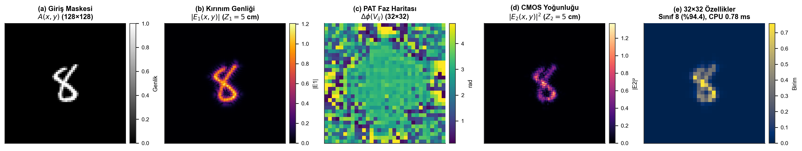
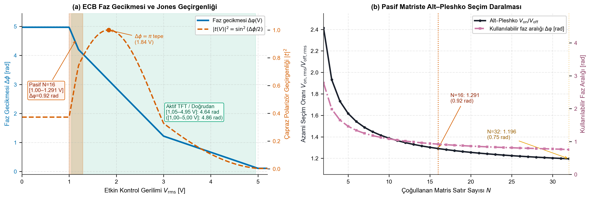
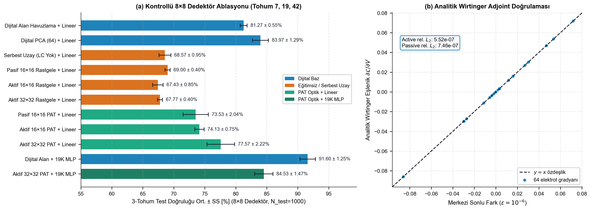
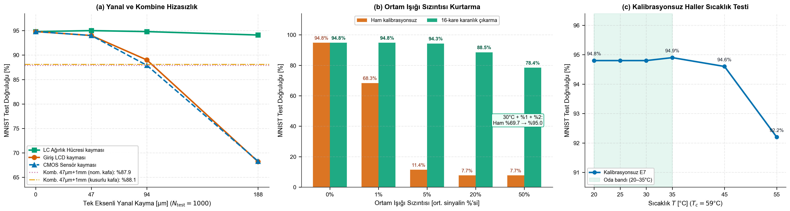
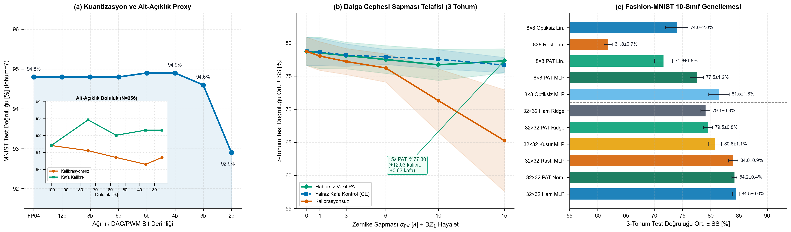

# ZERRE (Model H): Ortak-Yol Kırınımlı Optoelektronik İşlemcinin Dalga-Optiği Tasarımı, Fiziksel Sentezi ve Fizik-Farkındalıklı Eğitimi

**Hamza Solak**  
Bağımsız Araştırmacı, Türkiye  
E-posta: eng.hamzasolak@gmail.com | ORCID: [0009-0004-7541-9620](https://orcid.org/0009-0004-7541-9620)

---

## Özet

Programlanabilir optik sinir ağı işlemcileri çoğunlukla yüksek maliyetli uzamsal ışık modülatörlerine ve dalga boyu altı titreşimlere hassas çift kollu interferometrelere dayanmaktadır. Bu sayısal tasarım ve dalga-optiği simülasyon çalışmasında, yaygın monokrom maskeli stereolitografi (mSLA) sıvı kristal ekranları temel alan açık kaynaklı ortak-yol optoelektronik ZERRE (Model H) mimarisi sunulmaktadır. Ölçülmüş nematik saçılma zayıflaması doğrultusunda hacimsel nematik rezervuarlar termal Rayleigh–Gans saçılması (15–40 dB/cm) nedeniyle elenmiş; pasif matrisli ITO sürüşünün ise Alt–Pleshko sınırı uyarınca 16 satırlı bir dizide E7 faz aralığını 4,86 rad'dan (1,00–5,00 V) 0,921 rad'a daralttığı gösterilmiştir. Skaler Açısal Spektrum yayılımı ve kuple Jones modülasyonu için türetilen kapalı form Wirtinger eşlenik geri yayılımı (sonlu farklarla bağıl hata $5{,}52 \times 10^{-7}$), modellenmemiş donanım kusurlarına karşı Fizik-Farkındalıklı Eğitimi (PAT) mümkün kılmaktadır. Üç farklı tohumda ($N_{\text{test}}=1000$) kısıtlı $8 \times 8$ dedektör rejiminde PAT, lineer MNIST doğruluğunu eşleşmiş rastgele optiğe göre %67,77'den %77,57'ye (+9,80 puan) yükseltirken doğrudan dijital alan havuzlamanın (%81,27) 3,70 puan gerisinde kalmaktadır. Tam $32 \times 32$ okuma ve hibrit çok katmanlı algılayıcıyla kalibre doğruluk MNIST'te %94,37'ye ve Fashion-MNIST'te %84,20'ye ulaşarak ham piksel (%93,93, %84,47) ve rastgele optik (%94,20, %83,97) MLP'lerle eşdeğer kalmakta; 15 dalga boyu Zernike sapmasında kör PAT %77,30'a ulaşmakta (yalnız-kafa kalibrasyonunun [%76,67] +0,63 puan üzerinde) ve 4-bit basamaklamada %94,9'u korumaktadır. Tahmini bileşen bütçesi 784–959 USD'dir.

**Anahtar Kelimeler:** Açısal spektrum yöntemi, kırınımlı sinir ağları, sıvı kristal modülatörler, optoelektronik hesaplama, fizik-farkındalıklı eğitim, Wirtinger eşlenik.

---

## 1. Giriş

Modern CMOS ve GPU hızlandırıcılarında toplam çıkarım enerjisinin %60 ila %90'ı, aritmetik işlemlerden çok ağırlıkların ve aktivasyonların bellek hiyerarşisi ile ara bağlantılar boyunca taşınmasında harcanmaktadır [1, 2]. Serbest uzay ve entegre optik hesaplama mimarileri bu veri taşıma darboğazını analog düzeyde ele alır: yapılandırılmış kırınımlı veya faz modülasyonlu bir ortamdan geçen ışık alanı, $10\,\text{cm}$ uzunluğundaki bir optik yoldan $\sim 0{,}33\,\text{ns}$ sürede geçerken uzamsal süperpozisyon yoluyla yoğun doğrusal dönüşümleri pasif biçimde icra eder [3–5].

3B baskılı kırınımlı derin sinir ağları ($\text{D}^2\text{NN}$) terahertz bandında pasif sınıflandırma ortaya koymuş [5], ancak sabit dielektrik plakaların görev değişimine uyarlanamaması nedeniyle araştırmalar yeniden yapılandırılabilir sistemlere yönelmiştir. Takip eden çalışmalarda nanofotonik Mach–Zehnder ağları [6], büyük ölçekli kırınımlı işleme birimleri [7], entegre fotonik tensör çekirdekleri [8], zaman-dalga boyu çoğullaması [9] ve hibrit optik-elektronik evrişimli ön uçlar [10] geliştirilmiştir. Cep tipi sıvı kristal televizyonlarla başlayan [11] ve güncel uzamsal matris çarpıcılarla [12] sürdürülen paralel çalışmalar da ticari ekranların programlanabilir optik ağırlık olarak kullanılabileceğini göstermiştir.

Buna karşın deneysel erişilebilirliği kısıtlayan üç mühendislik engeli sürmektedir: laboratuvar tipi LCOS modülatörler düzlem başına 8.000–40.000 USD maliyet gerektirmekte; çift kollu interferometreler nanometre ölçeğindeki yol kaymalarında ($\lambda/4 \approx 133\,\text{nm}$) sönümlenmeye uğramakta [6]; ideal sayısal modellerde eğitilen ağırlıklar ise fiziksel hiza hataları ve pasif matrisli sıvı kristal hücrelerdeki etkin (RMS) voltaj kenetlenmesi nedeniyle doğruluk kaybetmektedir.

Bu makale, **ZERRE (Model H)** ortak-yol optoelektronik işlemci mimarisi ile açık kaynaklı dalga-optiği sayısal ikizinin tasarımını ve simülasyon analizini sunmaktadır; bu aşamada henüz fiziksel bir masaüstü prototip kurulmamış ve optik ölçüm alınmamıştır. Nematik sıvı kristallerdeki hacimsel saçılma sınırlarından [13] yola çıkılarak sekiz aday topoloji (Model A–H) taranmış ve birimi 40–60 USD olan monokrom mSLA 2K ekranlara dayalı düzlemsel $7\,\mu\text{m}$ ince hücre mimarisi seçilmiştir. Alt–Pleshko teoremi [14] uygulanarak $16 \times 16$ pasif matris taramasının ($1/5$ gerilim öngerilimi) RMS seçim oranını $1{,}290994$'e kısıtladığı ve kullanılabilir E7 faz aralığını $5{,}28\times$ daraltarak $4{,}86\,\text{rad}$'dan $0{,}921\,\text{rad}$'a düşürdüğü gösterilmiştir. Son olarak, Açısal Spektrum yayılımı üzerinden kapalı form Wirtinger eşlenik gradyanı türetilerek kusurlu fiziksel sistem simülatörü üzerinde Fizik-Farkındalıklı Eğitim (PAT) [15, 16] uygulanmış; üç rastgele tohumda MNIST ve Fashion-MNIST başarımı mekanik, termal, ortam ışığı, bit kuantizasyonu, alt-açıklık doluluğu ve Zernike sapma testleriyle birlikte sayısal olarak değerlendirilmiştir.

> **Şekil 1.** ZERRE Model H dalga-optiği hattında el yazısı bir MNIST rakamının ("8") skaler ileri yayılımı ($N=128^2$, $\Delta x=47\,\mu\text{m}$): **(a)** monokrom mSLA panelde kodlanan $A(x,y)$ genlik maskesi; **(b)** $Z_1=5\,\text{cm}$ Açısal Spektrum yayılımı sonrası LC ağırlık düzlemindeki kırınım genliği $|E_1(x,y)|$; **(c)** PAT ile eğitilmiş $32 \times 32$ aktif LC faz haritası $\Delta\phi(V_{ij})$ [rad]; **(d)** çapraz analizör ve $Z_2=5\,\text{cm}$ sonrası CMOS sensör yoğunluğu $|E_2(x,y)|^2$; **(e)** $32 \times 32$ havuzlanmış optik özellik haritası (%94,4 güvenle Sınıf 8 tahmini; $N=128^2$ ızgarada ortanca CPU simülasyon süresi $0{,}78\,\text{ms}$).

---

## 2. Mimari Sentez ve Fiziksel Kısıtlar

### 2.1 Hacimsel Nematik Saçılma Sınırı: Küreye Karşı İnce Hücre

Değerlendirilen sekiz kavramsal topolojiden (Model A–H) dört hacimsel nematik rezervuar tasarımı (32 elektrotlu Fibonacci küresi Model A, yarı-küre hibrit kase Model C, fotodiyot adreslemeli küre Model F ve küresel ITO matrisi Model G), üç boyutlu optik karışım sağlamak üzere santimetre ölçekli borosilikat kapları ($\varnothing 100\,\text{mm}$) Merck E7 ile doldurmayı incelemiştir. Ancak nematik fazda termal direktör dalgalanmaları, görünür dalga boylarında içsel soğurmadan yaklaşık iki mertebe daha güçlü Rayleigh–Gans saçılması üreterek $\alpha_{\text{scat}} \approx 15\text{–}40\,\text{dB/cm}$ zayıflama oluşturur [13]. $L = 10\,\text{cm}$ optik yol boyunca balistik iletim kaybı $150\text{–}400\,\text{dB}$ düzeyine ulaşır; koherent dalga cephesi foton difüzyonuna dönüşür ve mekanik sarsıntı altında sıvı çalkalanması direktör alanını bozar.

Buna karşılık E7 katmanını $d \le 7\,\mu\text{m}$ düzlemsel bir boşluğa hapsetmek saçılma kaybını $0{,}003\text{–}0{,}03\,\text{dB}$ aralığına indirir ve kılcal kuvvetler sıvıyı sabitler. $\lambda = 532\,\text{nm}$ için $7\,\mu\text{m}$ saf E7 ($\Delta n = 0{,}225$) $18{,}60\,\text{rad}$ ($\approx 5{,}92\pi$) çok-mertebeli faz gecikmesi üretirken, tek-mertebeli çalışma penceresi

$$
\Delta\phi_{\max} = \frac{2\pi}{\lambda}\,\Delta n_{\text{eff}}\, d \approx 4{,}97\,\text{rad} \; (\approx 1{,}58\pi) \tag{1}
$$

ya ticari mSLA TFT panellerdeki florlu nematik karışımlarla ($\Delta n_{\text{eff}} \approx 0{,}060$, $d = 7\,\mu\text{m}$), ya $d = 1{,}87\,\mu\text{m}$ ince E7 hücreyle, ya da $7\,\mu\text{m}$ E7'nin $V \ge 2{,}2\,\text{V}$ RMS öngerilim penceresinde sağlanır. Kalan düzlemsel ince hücre adayları arasında pasif $16 \times 16$ ITO plaka (Model B) Bölüm 2.3'te incelenen çoğullama sınırına takılmakta, tek 7 katmanlı yığın (Model D) $7\,\mu\text{m}$ hücre kesitini belirlemekte ve 3 katmanlı kaskad yığın (Model E) iletim kaybı ile hizalama maliyetini katlamakta; böylece tek ağırlık düzlemli ortak-yol mimari (Model H) uygulanabilir temel sentez olarak öne çıkmaktadır. Kalın hücre saçılmasına yönelik olası deneyler ise küre imalatı öncesinde düşük maliyetli $1\,\text{cm}$ cam küvette yapılacak geçirgenlik testiyle sınırlandırılmıştır.

### 2.2 Giriş Kodlama: Ticari mSLA Monokrom LCD Paneller

Maskeli stereolitografi (mSLA) 3B yazıcılar için seri üretilen monokrom LCD paneller, araştırma sınıfı LCOS modülatörlere erişilebilir bir seçenek oluşturur. Yaygın $5{,}5\,\text{inç}$ paneller $1440 \times 2560$ piksel ($\sim 47\,\mu\text{m}$ adım; $\sim 6{,}1\,\text{inç}$ modellerde $1620 \times 2560$) sunar, RGB renk filtresi ve arka aydınlatma içermeden çıplak transmisif vana olarak gelir ve standart HDMI–MIPI sürücü kartıyla $60\,\text{Hz}$ 8-bit gri tonda 40–60 USD karşılığında temin edilir. TFT veri yolları net açıklık geçirgenliğini %4–%8 düzeyine düşürse de $100\,\text{mW}$ $532\,\text{nm}$ DPSS lazer ve milisaniye mertebesinde CMOS pozlaması bunu telafi eder; $16{,}7\,\text{ms}$ çerçeve yenileme süresi de E7'nin $\sim 50\,\text{ms}$ viskoelastik gevşeme süresinden hızlıdır.

> **Şekil 2.** Nematik sıvı kristal ağırlık katmanında pasif matris çoğullama sınırı: **(a)** ECB faz gecikmesi $\Delta\phi(V_{\text{rms}})$ (mavi, sol eksen) ve $1{,}84\,\text{V}$ civarında $\Delta\phi = \pi$ noktasında tepe yapan monoton olmayan çapraz polarizör yoğunluk geçirgenliği $|t(V)|^2 = \sin^2(\Delta\phi/2)$ (kesikli turuncu, sağ eksen). Kırmızı alan $16 \times 16$ pasif taramanın dayattığı $[1{,}00\,\text{V},\, 1{,}291\,\text{V}]$ ($0{,}921\,\text{rad}$) penceresini, yeşil alan ise $[1{,}05, 4{,}95]\,\text{V}$ aktif PAT penceresindeki $4{,}64\,\text{rad}$ aralığını ($[1{,}00, 5{,}00]\,\text{V}$ üzerinde $4{,}86\,\text{rad}$) gösterir. **(b)** Satır sayısı $N$ $2$'den $32$'ye çıkarken Alt–Pleshko seçim oranının ve faz aralığının düşüşü.

### 2.3 Pasif Matris Sürüşte Alt–Pleshko RMS Kısıtı

$N \times N$ elektrotlu bir örgüyü $2N$ satır/sütun kanalıyla zaman çoğullamalı (örneğin $N=16$ için $1/5$ gerilim öngerilimi) sürmek ilk bakışta ekonomik görünür. Ancak nematik sıvı kristallerdeki dielektrik tork elektrik alanın karesiyle ($\propto E^2$) orantılı olduğundan ve $\sim 50\,\text{ms}$ pencere üzerinden ortalandığından, her hücre anlık darbeler yerine tüm tarama periyodu boyunca oluşan etkin (RMS) gerilime yanıt verir:

$$
V_{\text{rms}}(i,j) = \sqrt{\frac{1}{N}\left(V_{\text{sel}} + U_{ij}V_{\text{data}}\right)^2 + \frac{1}{N}\sum_{r\neq i}\left(U_{rj}V_{\text{data}}\right)^2}, \tag{2}
$$

burada $U_{rj} \in [-1, +1]$ normalize sütun ağırlıklarıdır. Optimum $V_{\text{sel}}/V_{\text{data}} = \sqrt{N}$ ($N=16$ için $4$) oranında Alt–Pleshko teoremi [14] ulaşılabilir en yüksek seçim oranını

$$
\frac{V_{\text{on,rms}}}{V_{\text{off,rms}}} \le \sqrt{\frac{\sqrt{N}+1}{\sqrt{N}-1}} \tag{3}
$$

ile sınırlar. $N=16$ satır için bu sınır $\sqrt{5/3} \approx 1{,}290994$'tür ($N=32$ için $1{,}195606$'ya düşer). Seçilmemiş pikseller $1{,}00\,\text{V}$ Freedericksz eşiğinde tutulduğunda seçili piksel en fazla $1{,}291\,\text{V}$ RMS alabilir; böylece E7 faz modülasyon aralığı $4{,}86\,\text{rad}$'dan $0{,}921\,\text{rad}$'a ($5{,}28\times$ daralma, **Şekil 2a**) inerken Denklem (2)'deki toplam terimi sütun boyunca çapraz etkileşim oluşturur. Bu nedenle Model H, pasif tarama yerine doğrudan AC kuplajlı PWM kanallarını veya her pikselinde depolama kondansatörü barındıran ikinci bir aktif-matris TFT mSLA panelini benimser.

---

## 3. Dalga-Optiği Modeli ve Fizik-Farkındalıklı Eğitim

### 3.1 Açısal Spektrum Yayılımı ve Kuple Jones Modülasyonu

Giriş mSLA paneli tarafından genlik modülasyonuna uğratılan doğrusal polarize ($0^\circ$) $532\,\text{nm}$ düzlem dalga $E_0(x,y) = A(x,y)$ alanını oluşturur ve $Z_1 = 5\,\text{cm}$ serbest uzay boyunca paraksiyel olmayan skaler Açısal Spektrum Yöntemi (ASM) ile yayılır [17]:

$$
E_1 = \mathcal{P}_{Z_1}\{E_0\} = \mathcal{F}^{-1}\!\left\{\mathcal{F}\{E_0\} \odot H(f_x, f_y; Z_1)\right\}, \tag{4}
$$

$$
H(f_x, f_y; z) = \exp\!\left(i\frac{2\pi}{\lambda}z\sqrt{1 - \lambda^2 f_x^2 - \lambda^2 f_y^2}\right) \cdot \mathbb{I}_{f_x^2+f_y^2 < \lambda^{-2}}, \tag{5}
$$

burada sönümlü bileşenler filtrelenir. Ağırlık düzleminde analitik model, çapraz polarizörler ($0^\circ/90^\circ$) arasında $45^\circ$ yönlendirilmiş paralel-hizalı elektriksel kontrollü çift-kırılım (ECB) hücresi varsayar; küresel sabit faz haricinde skaler Jones geçişi

$$
t(V_{ij}) = \sin\!\left(\frac{\Delta\phi(V_{ij})}{2}\right) \exp\!\left(i\frac{\Delta\phi(V_{ij})}{2}\right) \tag{6}
$$

olup $Z_2 = 5\,\text{cm}$ yayılımı sonrası $I_{\text{CMOS}} = |\mathcal{P}_{Z_2}\{E_1 \odot M(\mathbf{V})\}|^2$ yoğunluğu ortalanmış $K \times K$ dedektör bloklarında havuzlanarak $\mathbf{f} \in \mathbb{R}^{K^2}$ vektörüne dönüştürülür (**Şekil 1**). Parçalı-doğrusal elektro-optik eğride gerilim arttıkça $\Delta\phi(V)$ monoton biçimde $4{,}97\,\text{rad}$'dan ($1{,}00\,\text{V}$) $0{,}11\,\text{rad}$'a ($5{,}00\,\text{V}$) inerken ($4{,}86\,\text{rad}$ toplam aralık; aktif PAT eniyileme sınırları $[1{,}05, 4{,}95]\,\text{V}$ içinde $4{,}64\,\text{rad}$), $|t(V)|^2 = \sin^2(\Delta\phi/2)$ çarpanı monoton değildir ve $\Delta\phi = \pi$ noktasında tepe yapar (**Şekil 2a**). Denklem (6) ticari bükümlü nematik (TN) mSLA paneller için kapalı formda kuple genlik–faz vekili görevi görür [18]; TN panelle fiziksel kurulumda polarizör açılarının yeniden hizalanması ve deneysel kalibrasyon gerekir. PAT ileri/eşlenik FFT yayılımları `complex64` duyarlıkta, PAT-dışı analitik taramalar ve değerlendirme yolları ise `complex128` duyarlıkta yürütülür.

Piksel adımı $\Delta x = 47\,\mu\text{m}$ iken kritik ASM örnekleme boyutu $N_{\text{crit}} = \lambda Z_1 / \Delta x^2 \approx 12{,}0$ pikseldir; dolayısıyla $N=128$ (ve $256$) ızgaraları Nyquist koşulunu on kattan fazla aşar. $Z_1$ boyunca azami kırınım yayılması $Z_1\lambda/(2\Delta x) = 0{,}283\,\text{mm}$ olup $N=128$'deki $1{,}69\,\text{mm}$ ($2{,}63\,\text{mm}$ giriş görüntüsü) ve $0{,}75\,\text{mm}$ ($4{,}51\,\text{mm}$ aktif hücre) sıfır-dolgulu koruma bantlarının ($N=256$'da $2{,}73\,\text{mm}$ ve $1{,}50\,\text{mm}$) içinde kalarak dairesel sarmayı bastırır.

### 3.2 Wirtinger Kalkülüsü ile Analitik Eşlenik Geri Yayılım

Yüzlerce elektrot için sonlu fark değerlendirmesi yapmadan skaler kayıp $\mathcal{L}$'nin $\mathbf{V}$ gerilimlerine göre türevini almak üzere, $I = E_2 E_2^*$ için sensör düzlemindeki karmaşık Wirtinger hata alanı

$$
G_{\text{cam}} = 2 \left(\frac{\partial \mathcal{L}}{\partial I}\right) \odot E_2 \tag{7}
$$

biçiminde yazılır. Ayrık gerçel iç çarpım $\langle u, v \rangle = \operatorname{Re}\sum u^* v$ altında ASM operatörünün Hermitik eşleniği $-Z_2$ yönünde geri yayılımdır:

$$
G_{\text{mask}} = \mathcal{P}_{Z_2}^{\dagger}\{G_{\text{cam}}\} = \mathcal{F}^{-1}\!\left\{\mathcal{F}\{G_{\text{cam}}\} \odot H^*(f_x, f_y; Z_2)\right\}. \tag{8}
$$

Her elektrot makro-pikseli $\Omega_{ij}$ üzerinden $G_{t,ij} = \sum_{(u,v)\in\Omega_{ij}} E_1^*(u,v)\, G_{\text{mask}}(u,v)$ toplanıp $dt/d\phi = \frac{1}{2}e^{i\phi}$ uygulandığında tek bir ters/ileri FFT çiftiyle tam voltaj gradyanı elde edilir:

$$
\frac{\partial \mathcal{L}}{\partial V_{ij}} = \operatorname{Re}\!\left\{G_{t,ij}^* \cdot \frac{1}{2}e^{i\Delta\phi(V_{ij})}\right\} \cdot \left.\frac{d\Delta\phi}{dV}\right|_{V_{ij}}. \tag{9}
$$

Merkezi sonlu farklarla ($\varepsilon = 10^{-6}$) yapılan doğrulamada Denklem (9), aktif modda $5{,}52 \times 10^{-7}$, pasif Alt–Pleshko zincir kuralı altında ise $7{,}46 \times 10^{-7}$ bağıl $L_2$ hatası vermektedir (**Şekil 3b**).

> **Şekil 3.** **(a)** Kusurlu fiziksel sistem simülatöründe $8 \times 8$ dedektör rejimindeki tüm 11 eşleşmiş yapılandırmada 3 tohumlu sızıntısız MNIST test doğrulukları (ortalama $\pm$ 1 SS, $N_{\text{test}}=1000$). PAT ile eğitilen $32 \times 32$ aktif optik katman, eşleşmiş rastgele optiği $+9{,}80$ puan geçerken (%77,57 ve %67,77) doğrudan dijital alan havuzlamanın (%81,27) 3,70 puan altında kalır. **(b)** Analitik Wirtinger eşlenik gradyanının merkezi sonlu farklarla ($\varepsilon=10^{-6}$) parametre bazlı uyumu.

### 3.3 Fizik-Farkındalıklı Eğitim ve Karanlık-Kare Stabilizasyonu

Gerçek optik düzeneklerde montaj kaymaları, sıcaklık sapmaları ve okuma gürültüsü bulunacağı için PAT döngüsü [15] ileri geçiş çıktılarını kusurlu fiziksel sistem simülatöründen alırken, optik geri adımları Denklemler (7)–(9) ile nominal sayısal ikiz üzerinden hesaplar (gradyansız yedek olarak SPSA [19] tutulur). Ortam ışığı sızıntısı altında sıfır varyansa yakın kenar piksellerinin standartlaştırmada şişmesini engellemek amacıyla 16 kareli gürültülü karanlık arka plan çıkarma ve yalnızca eğitim kümesine dayalı bir standart sapma tabanı uygulanır:

$$
\tilde{\mathbf{f}} = \frac{(\mathbf{f}_{\text{on}} - \mathbf{f}_{\text{dark}}) - \boldsymbol{\mu}_{\text{tr}}}{\max\!\left(\boldsymbol{\sigma}_{\text{tr}},\, 0{,}05\cdot\operatorname{mean}(\boldsymbol{\sigma}_{\text{tr}})\right)}, \tag{10}
$$

burada $\boldsymbol{\mu}_{\text{tr}}$ ve $\boldsymbol{\sigma}_{\text{tr}}$ test sızıntısı olmadan yalnızca eğitim verisinden hesaplanır.

| Parametre | Değer / Şartname |
| :--- | :--- |
| Dalga boyu $\lambda$ / Piksel adımı $\Delta x$ | $532\,\text{nm}$ / $47\,\mu\text{m}$ |
| Eksenel mesafeler $Z_1$, $Z_2$ | $50\,\text{mm}$, $50\,\text{mm}$ ($10\,\text{cm}$ yol, $0{,}33\,\text{ns}$) |
| Izgara boyutları $N$ | $128 \times 128$ ($6{,}02\,\text{mm}$), $256 \times 256$ ($12{,}03\,\text{mm}$) |
| ASM kritik boyut / Yayılma | $N_{\text{crit}} = 12{,}0\,\text{px}$ / $0{,}283\,\text{mm}$ |
| Koruma bantları ($N=128$) | $1{,}69\,\text{mm}$ (giriş), $0{,}75\,\text{mm}$ (ağırlık) |
| Aktif / Pasif kontrol sınırları | $[1{,}05, 4{,}95]\,\text{V}$ ($4{,}64\,\text{rad}$) / $[-1, +1]$ ($0{,}921\,\text{rad}$) |
| Eniyileyici | Adam ($\text{lr}_{\text{opt}}=0{,}07\text{–}0{,}10$; $\text{lr}_{\text{head}}=2{,}5 \times 10^{-2}$ / $2{,}5 \times 10^{-3}$) |
| Düzenlileme / Takvim | $10^{-4}$ $L_2$; $16\text{–}22$ ep. (PAT), $40\text{–}45$ ep. (MLP); erken durdurma |
| Kusurlu sistem hataları | $47\,\mu\text{m}$ LCD/CMOS, $+1{,}2$/$-0{,}8\,\text{mm}$ $Z$, $29\,^\circ\text{C}$, %2 drift |
| Tohumlar / Test örneği | $\{7, 19, 42\}$ / bölme başına $N_{\text{test}}=1000$ |

> **Tablo 1.** Simülasyon düzeneği, optik geometri ve eğitim hiperparametreleri.

---

## 4. Sayısal Bulgular ve Analiz

### 4.1 Kontrollü 8×8 Dedektör MNIST Ablasyonu

Tüm sayısal deneyler Python 3.11.9 / NumPy 2.2.3 ortamında CPU üzerinde (Intel64 Family 6 Model 170) PAT yollarında `complex64`, PAT-dışı/değerlendirme yollarında `complex128` duyarlıkla ve **Tablo 1**'de özetlenen hiperparametrelerle çalıştırılmıştır. Elektronik okuma bant genişliği sıkı şekilde kısıtlandığında programlanabilir optik ağırlıkların net katkısını ölçmek için $8 \times 8 = 64$ dedektör üzerinde üç tohumla 11 eşleşmiş MNIST [20] yapılandırması karşılaştırılmıştır ($N_{\text{fit}}=2640$, $N_{\text{val}}=360$, $N_{\text{test}}=1000$). Fiziksel simülatör; vekil ikizin bilmediği $47\,\mu\text{m}$ LCD ve sensör kayması, $+1{,}2\,\text{mm}/-0{,}8\,\text{mm}$ eksenel hata, $29\,^\circ\text{C}$ Haller sıcaklık sapması [21, 22], %2 lazer drifti ve Gauss okuma gürültüsü içermektedir (**Tablo 2**, **Şekil 3a**).

| # | Mimari / Yapılandırma | Opt. W | Dij. W | Test (%) |
| :-: | :--- | --: | --: | --: |
| 1 | Dijital Alan Havuzlama ($8 \times 8$) + Lineer | 0 | 650 | 81,27 ± 0,55 |
| 2 | Dijital PCA Temeli ($64$-boyut) + Lineer | 0 | 650ᵃ | 83,97 ± 1,29 |
| 3 | Yalnız Serbest Uzay Kırınımı (LC Yok) | 0 | 650 | 68,57 ± 0,95 |
| 4 | Pasif $16 \times 16$ Rastgele + Lineer | 256 | 650 | 69,00 ± 0,40 |
| 5 | Aktif $16 \times 16$ Rastgele + Lineer | 256 | 650 | 67,43 ± 0,85 |
| 6 | Aktif $32 \times 32$ Rastgele + Lineer | 1.024 | 650 | 67,77 ± 0,40 |
| 7 | Pasif $16 \times 16$ + PAT + Lineer | 256 | 650 | 73,53 ± 2,04 |
| 8 | Aktif $16 \times 16$ + PAT + Lineer | 256 | 650 | 74,13 ± 0,75 |
| **9** | **Aktif $32 \times 32$ + PAT + Lineer** | **1.024** | **650** | **77,57 ± 2,22** |
| 10 | Dijital Alan Havuzlama ($8 \times 8$) + MLP | 0 | 19.210 | 91,60 ± 1,25 |
| **11** | **Aktif $32 \times 32$ + PAT + MLP** | **1.024** | **19.210** | **84,53 ± 1,47** |

ᵃEğitim kümesinden kurulan $784 \times 64$ lineer PCA izdüşüm matrisi hariç.

> **Tablo 2.** Kusurlu sistemde kontrollü MNIST ablasyonu ($8 \times 8$ dedektör, 3 tohum, $N_{\text{test}}=1000$).

**Tablo 2** iki net sonuç ortaya koymaktadır. Birincisi, optimize edilmemiş kırınım, uzamsal enerjiyi kaba pikseller arasında dağıttığı için doğrudan $8 \times 8$ dijital görüntülemeye göre doğruluğu belirgin biçimde düşürür (%67,77–%69,00'a karşı %81,27). $32 \times 32$ aktif LC ağırlıklarının PAT ile eniyilenmesi, eşleşmiş rastgele optiğe kıyasla $+9{,}80$ puan (%67,77 → %77,57) ve yalın serbest uzaya kıyasla $+9{,}00$ puan kazanım sağlar. Buna karşın $16 \times 16$ optik çözünürlükte pasif PAT (%73,53 ± 2,04) ile aktif PAT (%74,13 ± 0,75) bir standart sapma içinde istatistiksel olarak eşdeğerdir, çünkü dar $8 \times 8$ okuma faz aralığından çok okuma sırasını (rank) kısıtlamaktadır. İkincisi, pozitif kare-yasa yoğunluğu üzerinde çalışan tek bir programlanabilir kırınım katmanı, gürültüsüz dijital $8 \times 8$ alan havuzlamanın (%77,57 ve %81,27; 19K MLP ile %84,53 ve %91,60) gerisinde kalırken veri güdümlü dijital PCA-64 izdüşümü doğrusal üst sınırı %83,97 ± 1,29 olarak belirler.

### 4.2 MNIST ve Fashion-MNIST Üzerinde Tam 32×32 Hibrit Sınıflandırma

CMOS dedektör örgüsünün $32 \times 32$ (1.024 özellik) boyutuna çıkarılması, hem MNIST [20] hem de 10 sınıflı Fashion-MNIST [23] veri kümelerinde optik ve elektronik kapasitenin nasıl etkileştiğini açıkça gösterir (**Tablo 3**). $N_{\text{train}}=6000$ iken düzenlileştirilmiş Ridge lineer okuyucuyla sabit rastgele $32 \times 32$ optik maske MNIST'te ham $28 \times 28$ pikselleri geçerken (%85,57 ± 1,76 ve %82,93 ± 1,70), Fashion-MNIST'te PAT-eğitimli $32 \times 32$ Ridge okuyucu ham piksellerle 1 standart sapma içinde karşılaştırılabilirdir (%79,50 ± 0,80 ve %79,07 ± 0,81).

| Yapılandırma | Opt. W | Dij. W | MNIST (%) | F-MNIST (%) |
| :--- | --: | --: | --: | --: |
| Ham $28 \times 28$ Dijital Ridge ($N=6\text{k}$) | 0 | 7.850 | 82,93 ± 1,70 | 79,07 ± 0,81 |
| Opt. $16 \times 16$, 256öz. Ridge ($N=2{,}5\text{k}$) | 256 | 2.570 | 81,73 ± 0,72 | — |
| Opt. $16 \times 16$, 1024öz. Ridge ($N=2{,}5\text{k}$) | 256 | 10.250 | 84,77 ± 1,00 | — |
| Opt. $32 \times 32$ Rast., 1024öz. Ridge ($N=6\text{k}$) | 1.024 | 10.250 | 85,57 ± 1,76 | — |
| Opt. $32 \times 32$ PAT, 1024öz. Ridge ($N=6\text{k}$) | 1.024 | 10.250 | — | 79,50 ± 0,80 |
| Ham $28 \times 28$ Dijital MLP ($N=6\text{k}$) | 0 | 203.530 | 93,93 ± 0,99 | 84,47 ± 0,55 |
| $32 \times 32$ Rastgele Optik + MLP | 1.024 | 264.970 | 94,20 ± 0,95 | 83,97 ± 0,86 |
| $32 \times 32$ PAT + MLP (Kusurlu) | 1.024 | 264.970 | 89,77 ± 3,27 | 80,80 ± 1,15 |
| **$32 \times 32$ PAT + MLP (Kalibre)** | **1.024** | **264.970** | **94,37 ± 0,84** | **84,20 ± 0,44** |

> **Tablo 3.** Tam ölçekli $32 \times 32$ hibrit ve dijital karşılaştırma (3 tohum, $N_{\text{test}}=1000$).

Buna karşılık $1024 \to 256 \to 10$ ReLU MLP (264.970 dijital ağırlık) eklendiğinde sınıflandırma başarımını elektronik kapasite belirler: kalibre nominal PAT (%94,37 MNIST, %84,20 Fashion-MNIST), sabit rastgele optikli MLP (%94,20 ve %83,97) ve ham piksel MLP (%93,93 ve %84,47) yaklaşık $0{,}5$ puan içinde toplanmaktadır; telafi edilmemiş kusurlu sistemde ise PAT MLP %89,77 (MNIST) ve %80,80 (Fashion-MNIST) elde etmektedir. Kısıtlı $8 \times 8$ Fashion-MNIST rejiminde ise (**Şekil 5c**) PAT lineer sınıflandırma rastgele optiği yine $+9{,}80$ puan aşarak %71,63'e (%61,83'e karşı), 19K MLP ile %77,53'e ulaşmakta; doğrudan $8 \times 8$ dijital havuzlama %74,00 (lineer) ve %81,47 (MLP) vermektedir.

> **Şekil 4.** Mekanik ve çevresel dayanıklılık testleri ($N_{\text{test}}=1000$, tohum 7, nominal baz %94,8): **(a)** LC ağırlık hücresi ($188\,\mu\text{m}$'de %94,8 → %94,1), giriş LCD (%94,8 → %68,2) ve CMOS sensör (%94,8 → %68,3) tek eksenli yanal kaymaları ile kombine $47\,\mu\text{m} + 1\,\text{mm}$ sapması (nominal kafa %87,9; kusurla eğitilmiş kafa %88,1, baz %87,8); **(b)** ortam ışığı sızıntısında ham çöküşe karşı 16 kareli karanlık-kare çıkarma ve $30\,^\circ\text{C}+\%1+\%2$ birleşik iyileşme (%69,7 → %95,0); **(c)** kalibrasyonsuz E7 Haller sıcaklık taraması ($20\text{–}55\,^\circ\text{C}$, $T_c=59\,^\circ\text{C}$).

### 4.3 Mekanik Hizalama, Sıcaklık Kayması ve Ortam Işığı Dayanımı

Harici referans kolu içermeyen ortak-yol optik düzlemde eksenel yoğunluk toleransı Talbot uzunluğuyla ($z_T = 2\Delta x^2/\lambda \approx 8{,}3\,\text{mm}$) belirlenir. 1.000 MNIST test örneğinde (tohum 7, baz %94,8, **Şekil 4a**), LC ağırlık katmanının $188\,\mu\text{m}$ yanal kayması en fazla 0,7 puan kayıp oluşturur (%94,8 → %94,1) çünkü gelen alan uzamsal olarak yumuşaktır. Giriş LCD ve CMOS sensör kaymaları $47\,\mu\text{m}$ (%94,0) ötesinde daha keskin düşer ($188\,\mu\text{m}$'de %68,2 ve %68,3); eksenel $\Delta Z_1 \in [0, 8\,\text{mm}]$ sapmaları ise %94,7–%95,1 aralığında kalır. Tüm düzlemlerin eşzamanlı $47\,\mu\text{m}$ yanal ve $+1\,\text{mm}$ eksenel kaydığı kombine testte nominal kafa %87,9'a ($-6{,}9$ puan) inerken, pertürbe sistemle eğitilmiş kafa %87,8 bazına göre %88,1 değerini korur.

Haller bağıntısıyla [21, 22] modellenen termal kaymada:

$$
\frac{\Delta n(T)}{\Delta n(25\,^\circ\text{C})} = \left(\frac{T_c - T}{T_c - 25}\right)^{\!\beta}, \qquad T_c = 59\,^\circ\text{C},\; \beta = 0{,}22, \tag{11}
$$

kalibrasyonsuz doğruluk $20\text{–}35\,^\circ\text{C}$ arasında %94,8–%94,9 düzeyinde kalıp berraklaşma noktasına yakın $55\,^\circ\text{C}$'de %92,2'ye iner (**Şekil 4c**). Arka plan çıkarma olmadan ortalama sinyalin %1 ve %5'i kadar ortam ışığı sızıntısı doğruluğu %68,3 ve %11,4'e düşürürken, 16 kareli karanlık arka plan çıkarma ve Denklem (10) sırasıyla %94,8 (%1), %94,3 (%5), %88,5 (%20) ve %78,4 (%50) sağlar; kombine $30\,^\circ\text{C}$ + %1 sızıntı + %2 lazer drift testini ise %69,7'den %95,0'a çıkarır. Lazer gücü $\pm 10\%$ değiştiğinde doğruluk %94,7–%95,0 aralığındadır.

> **Şekil 5.** Donanım gerçekçiliği ve genelleme testleri ($N_{\text{test}}=1000$): **(a)** 8-bit HDMI giriş ve $b$-bit ağırlık basamaklaması (4-bit'e kadar %94,8–%94,9, 2-bit'te %92,9) ve makro-piksel alt-açıklık doluluğu iç grafiği (%25 dolulukta kalibrasyonsuz %91,4 → %90,7, kafa kalibre %91,4 → %92,3); **(b)** 3 tohumlu Zernike dalga cephesi sapmaları ($0\text{–}15\lambda$ PV + $3Z_1$ hayalet): kalibrasyonsuz (%65,27 ± 7,67), eşleşmiş CE yalnız-kafa kontrolü (%76,67 ± 1,15) ve habersiz vekil PAT (%77,30 ± 1,82); **(c)** 3 tohumlu 10 sınıflı Fashion-MNIST karşılaştırması.

### 4.4 Bit Kuantizasyonu, Alt-Açıklık Vekili ve Dalga Cephesi Sapması

Masaüstü kurulumu öncesi üç ek gerçekçilik testi daha yürütülmüştür (**Şekil 5a–b**). 8-bit HDMI giriş ve $b$-bit LC kontrol gerilimi kuantizasyonunda (tohum 7) doğruluk 4-bit'e (16 gerilim seviyesi) kadar %94,8–%94,9'da kalıp 3-bit'te %94,6 ve 2-bit'te %92,9 olmaktadır. $N=256$ ızgarada %100'den %25'e inen makro-piksel alt-açıklık vekil testinde kalibrasyonsuz doğruluk %91,4'ten %90,7'ye inerken, dijital kafa yeniden kalibrasyonu %92,3 sağlamaktadır.

Beşinci derece Zernike sapmaları ($0\text{–}15\lambda$ PV) ile $3Z_1$ Fabry–Pérot hayaleti (0,04 genlik) eklendiğinde, tüm koşullar eşit çapraz entropi Adam kafasıyla değerlendirildiğinde dikkate değer bir ayrım görülür (**Şekil 5b**): $1\lambda$–$10\lambda$ aralığında donmuş optikle yalnız kafayı yeniden kalibre etmek kaybın neredeyse tamamını telafi ederek (%78,63 ve %77,53) habersiz vekil PAT'ye (%78,50 ve %76,70) denk sonuç verirken, ağır $15\lambda$ sapmada kalibrasyonsuz sistem %65,27 ± 7,67'ye düşmekte, yalnız-kafa kalibrasyonu %76,67 ± 1,15'e, ortak optik adaptasyonlu PAT ise %77,30 ± 1,82'ye ulaşmaktadır.

| Alt Sistem | Seçilen Donanım | Tutar (USD) |
| :--- | :--- | --: |
| Optik Giriş | $532\,\text{nm}$ DPSS ($100\,\text{mW}$) + Genişletici + mSLA LCD | 150 |
| Aktif Ağırlıklar | 2. mSLA TFT-LCD (veya ITO Hücre + AC-PWM) | 90–230 |
| Okuma ve Kontrol | RPi Camera 3 (IMX708, $12\,\text{MP}$) + M12 + RPi 5 | 125 |
| Optomekanik | Optik Ray, Tutucular, Karartılmış Kutu, Filtre | 262 |
| Ara Toplam | Temel optik ve elektronik bileşenler | 627–767 |
| **Toplam (+%25)** | **Yedek payı dahil masaüstü prototip** | **784–959** |

> **Tablo 4.** Tahmini prototip malzeme bütçesi (BOM).

---

## 5. Tartışma, Sınırlılıklar ve Donanım Yol Haritası

**Tablo 4**'te kalemlendirilen modüler optik ray kurulumu doğrudan bileşenlerde 627–767 USD, %25 yedek payıyla 784–959 USD tutmaktadır. Sistemde üç farklı zaman ölçeği birbirinden ayrı tutulmalıdır: $10\,\text{cm}$ optik yol boyunca koherent foton geçişi $\sim 0{,}33\,\text{ns}$ sürerken, gerçek donanım akış hızını $60\,\text{Hz}$ LCD/kamera çerçeve döngüsü ($\sim 16{,}7\,\text{ms}$) ve ağırlık güncellemelerinde $\sim 50\,\text{ms}$ nematik gevşeme süresi belirler; $N=128^2$ ızgarada CPU üzerindeki derlenmemiş NumPy ASM simülasyonu ise 50 çalışmada $0{,}78\,\text{ms}$ ortanca sürede (Intel64 Family 6 Model 170 CPU, Python 3.11.9 / NumPy 2.2.3, ortalama $0{,}87\,\text{ms}$, IQR $0{,}08\,\text{ms}$, aralık $0{,}71\text{–}2{,}74\,\text{ms}$) tamamlanmaktadır.

Fiziksel montaj basitleştirilmiş 2B modellerde yer almayan üç mühendislik koşulu gerektirir: RPi Camera Module 3'ün IMX708 sensörü ($6{,}45 \times 3{,}63\,\text{mm}$) kısa eksende $4{,}51\text{–}6{,}02\,\text{mm}$ kırınım alanından dar olduğundan $\sim 1{,}6\times$ küçültücü M12 röle optiği gerekir; $100\,\text{mW}$ $532\,\text{nm}$ DPSS lazer Sınıf 3B olması nedeniyle OD 4+ gözlük, ışık sızdırmaz kasa ve $808/1064\,\text{nm}$ pompa kaçağını kesen IR filtre gerektirir; ayrıca PCA9685 PWM kartları tek kutuplu darbe ürettiğinden çıplak ITO elektrotlarda elektrolizi önlemek için AC polarite-evirici sürücü devre olmadan kullanılmamalıdır.

### 5.1 Sınırlılıklar

Altı temel sınırlılık bu sayısal bulguların kapsamını belirlemektedir. İlk olarak tüm doğruluk ve dayanıklılık verileri dalga-optiği simülasyonlarına dayanmaktadır; fiziksel kurulum, hizalama ve gerçek sensör gürültüsü ölçümleri sonraki deneysel aşamayı oluşturmaktadır. İkinci olarak $8 \times 8$ dedektörlerde PAT optik katmanı rastgele optiği $+9{,}80$ puan aşsa da doğrudan dijital alan havuzlamanın gerisinde kalmakta (%77,57 ve %81,27), $32 \times 32$'de 265K parametreli MLP eklendiğinde ise sınıflandırmayı elektronik kafa baskılayarak farkları $\sim 0{,}5$ puan içine sıkıştırmaktadır.

Üçüncü sınırlılık Denklem (6)'nın paralel ECB hücresini modellemesidir; ticari TN mSLA panellerdeki polarizasyon dönüşü [18] deneysel lookup tablosu gerektirir. Dördüncüsü, skaler simülasyonlar monokrom düzlem dalga varsaymakta; DPSS lazer benek gürültüsü, sonlu koherens uzunluğu ve 0,04 hayalet dışındaki çoklu yansımaları ihmal etmektedir. Beşincisi, her $32 \times 32$ ağırlık bloğu onlarca $47\,\mu\text{m}$ mSLA alt-pikselini grupladığından $N=256$ alt-açıklık testi ölçeklenmiş bir vekil niteliğindedir. Altıncısı, tek bir kusurlu düzenek için eğitilen ağırlıklar, Keskinlik-Farkındalıklı Eğitim [24] gibi yöntemlerle genişletilmedikçe farklı hizalanmış ikinci bir hücreye doğrudan aktarılamaz.

---

## 6. Sonuç

Nematik Rayleigh–Gans saçılma sınırları (15–40 dB/cm) ve Alt–Pleshko RMS voltaj kısıtları ($5{,}28\times$ daralma) temelinde sentezlenen ortak-yol ZERRE (Model H) mimarisi, ticari mSLA ekranları 784–959 USD bütçe sınırı içinde bir araya getirmektedir. Skaler ASM kırınımı üzerinden türetilen Wirtinger eşlenik operatörü, kusurlu simülasyonlarda PAT eğitimini mümkün kılarak $8 \times 8$ lineer MNIST doğruluğunu rastgele optiğe göre $+9{,}80$ puan artırmış (%77,57), $32 \times 32$ hibrit okuma ile MNIST'te %94,37 ve Fashion-MNIST'te %84,20 başarım elde etmiş; ayrıca tek-katman optik ağırlıkların sınırlarını ve deneysel kurulum adımlarını açıkça ortaya koymuştur.

---

## Veri ve Kod Erişilebilirliği

Tüm Python dalga-optiği simülasyon kodları (`zerre_twin.py`, `zerre_pat_torch.py`), etkileşimli WebGL/ASM görselleştiricisi (`start_server.py`), otomatik fizik birim testleri (`tests/test_zerre_physics.py`), 3 tohumlu kıyaslama çıktıları (`makale/scripts/paper_results.json`) ve şekil/makale derleme betikleri; yazılım kodları için **MIT Lisansı**, makale metni ve şekiller için ise **CC BY 4.0 Lisansı** altında standart MNIST ve Fashion-MNIST yerel önbellek desteğiyle [https://github.com/hamzasolak/zerre](https://github.com/hamzasolak/zerre) adresinde (sürüm etiketi `v0.4.0`; Yazar ORCID: [0009-0004-7541-9620](https://orcid.org/0009-0004-7541-9620)) yayımlanmaktadır.

## Finansman

Bu çalışma herhangi bir kurum veya ticari fon desteği olmaksızın bağımsız araştırma olarak yürütülmüştür.

## Çıkar Çatışması Beyanı

Yazar herhangi bir çıkar çatışması bulunmadığını beyan eder.

## Teşekkür

Makalenin I–VI. Bölümlerinde üslup düzenleme, LaTeX biçimlendirme ve kod-doğrulama denetimi için üretken yapay zekâ araçlarından (Gemini ve Claude) yararlanılmıştır; fiziksel tasarım, dalga-optiği simülasyon kodları, çok-tohumlu deneylerin yürütülmesi ve tüm bilimsel iddialar ile sonuçlar tamamen yazarın sorumluluğundadır.

---

## Kaynaklar

1. M. Horowitz, "1.1 Computing's energy problem (and what we can do about it)," *IEEE International Solid-State Circuits Conference Digest of Technical Papers (ISSCC)*, San Francisco, CA, ABD, s. 10–14, 2014. DOI: [10.1109/ISSCC.2014.6757323](https://doi.org/10.1109/ISSCC.2014.6757323)
2. V. Sze, Y.-H. Chen, T.-J. Yang ve J. S. Emer, "Efficient Processing of Deep Neural Networks: A Tutorial and Survey," *Proceedings of the IEEE*, c. 105, no. 12, s. 2295–2329, 2017. DOI: [10.1109/JPROC.2017.2761740](https://doi.org/10.1109/JPROC.2017.2761740)
3. G. Wetzstein, A. Ozcan, S. Gigan, S. Fan, D. Englund, M. Soljačić, C. Denz, D. A. B. Miller ve D. Psaltis, "Inference in artificial intelligence with deep optics and photonics," *Nature*, c. 588, no. 7836, s. 39–47, 2020. DOI: [10.1038/s41586-020-2973-6](https://doi.org/10.1038/s41586-020-2973-6)
4. D. Psaltis ve N. H. Farhat, "Optical information processing based on an associative-memory model of neural nets with thresholding and feedback," *Optics Letters*, c. 10, no. 2, s. 98–100, 1985. DOI: [10.1364/OL.10.000098](https://doi.org/10.1364/OL.10.000098)
5. X. Lin, Y. Rivenson, N. T. Yardimci, M. Veli, Y. Luo, M. Jarrahi ve A. Ozcan, "All-optical machine learning using diffractive deep neural networks," *Science*, c. 361, no. 6406, s. 1004–1008, 2018. DOI: [10.1126/science.aat8084](https://doi.org/10.1126/science.aat8084)
6. Y. Shen, N. C. Harris, S. Skirlo, M. Prabhu, T. Baehr-Jones, M. Hochberg, X. Sun, S. Zhao, H. Larochelle, D. Englund ve M. Soljačić, "Deep learning with coherent nanophotonic circuits," *Nature Photonics*, c. 11, no. 7, s. 441–446, 2017. DOI: [10.1038/nphoton.2017.93](https://doi.org/10.1038/nphoton.2017.93)
7. T. Zhou, X. Lin, J. Wu, Y. Chen, H. Xie, Y. Li, J. Fan, L. Wu, L. Fang ve Q. Dai, "Large-scale neuromorphic optoelectronic computing with a reconfigurable diffractive processing unit," *Nature Photonics*, c. 15, no. 5, s. 367–375, 2021. DOI: [10.1038/s41566-021-00796-w](https://doi.org/10.1038/s41566-021-00796-w)
8. J. Feldmann vd., "Parallel convolutional processing using an integrated photonic tensor core," *Nature*, c. 589, no. 7840, s. 52–58, 2021. DOI: [10.1038/s41586-020-03070-1](https://doi.org/10.1038/s41586-020-03070-1)
9. X. Xu vd., "11 TOPS photonic convolutional accelerator for optical neural networks," *Nature*, c. 589, no. 7840, s. 44–51, 2021. DOI: [10.1038/s41586-020-03063-0](https://doi.org/10.1038/s41586-020-03063-0)
10. J. Chang, V. Sitzmann, X. Dun, W. Heidrich ve G. Wetzstein, "Hybrid optical-electronic convolutional neural networks with optimized diffractive optics for image classification," *Scientific Reports*, c. 8, makale no. 12324, 2018. DOI: [10.1038/s41598-018-30619-y](https://doi.org/10.1038/s41598-018-30619-y)
11. F. T. S. Yu, T. Lu, X. Yang ve D. A. Gregory, "Optical neural network with pocket-sized liquid-crystal televisions," *Optics Letters*, c. 15, no. 15, s. 863–865, 1990. DOI: [10.1364/OL.15.000863](https://doi.org/10.1364/OL.15.000863)
12. J. Spall, X. Guo, T. D. Barrett ve A. I. Lvovsky, "Fully reconfigurable coherent optical vector–matrix multiplication," *Optics Letters*, c. 45, no. 20, s. 5752–5755, 2020. DOI: [10.1364/OL.401675](https://doi.org/10.1364/OL.401675)
13. S.-T. Wu ve K.-C. Lim, "Absorption and scattering measurements of nematic liquid crystals," *Applied Optics*, c. 26, no. 9, s. 1722–1727, 1987. DOI: [10.1364/AO.26.001722](https://doi.org/10.1364/AO.26.001722)
14. P. M. Alt ve P. Pleshko, "Scanning limitations of liquid-crystal displays," *IEEE Transactions on Electron Devices*, c. 21, no. 2, s. 146–155, 1974. DOI: [10.1109/T-ED.1974.17884](https://doi.org/10.1109/T-ED.1974.17884)
15. L. G. Wright, T. Onodera, M. M. Stein, T. Wang, D. T. Schachter, Z. Hu ve P. L. McMahon, "Deep physical neural networks trained with backpropagation," *Nature*, c. 601, no. 7894, s. 549–555, 2022. DOI: [10.1038/s41586-021-04223-6](https://doi.org/10.1038/s41586-021-04223-6)
16. T. W. Hughes, M. Minkov, Y. Shi ve S. Fan, "Training of photonic neural networks through in situ backpropagation and gradient measurement," *Optica*, c. 5, no. 7, s. 864–871, 2018. DOI: [10.1364/OPTICA.5.000864](https://doi.org/10.1364/OPTICA.5.000864)
17. J. W. Goodman, *Introduction to Fourier Optics*, 4. baskı, W. H. Freeman, New York, NY, ABD, 2017, ISBN 978-1-319-11916-4.
18. K. Lu ve B. E. A. Saleh, "Theory and design of the liquid crystal TV as an optical spatial phase modulator," *Optical Engineering*, c. 29, no. 3, s. 240–246, 1990. DOI: [10.1117/12.55584](https://doi.org/10.1117/12.55584)
19. J. C. Spall, "Implementation of the simultaneous perturbation algorithm for stochastic optimization," *IEEE Transactions on Aerospace and Electronic Systems*, c. 34, no. 3, s. 817–823, 1998. DOI: [10.1109/7.705889](https://doi.org/10.1109/7.705889)
20. Y. LeCun, L. Bottou, Y. Bengio ve P. Haffner, "Gradient-based learning applied to document recognition," *Proceedings of the IEEE*, c. 86, no. 11, s. 2278–2324, 1998. DOI: [10.1109/5.726791](https://doi.org/10.1109/5.726791)
21. I. Haller, "Thermodynamic and static properties of liquid crystals," *Progress in Solid State Chemistry*, c. 10, s. 103–118, 1975. DOI: [10.1016/0079-6786(75)90008-4](https://doi.org/10.1016/0079-6786(75)90008-4)
22. J. Li, C.-H. Wen, S. Gauza, R. Lu ve S.-T. Wu, "Refractive indices of liquid crystals for display applications," *Journal of Display Technology*, c. 1, no. 1, s. 51–61, 2005. DOI: [10.1109/JDT.2005.853357](https://doi.org/10.1109/JDT.2005.853357)
23. H. Xiao, K. Rasul ve R. Vollgraf, "Fashion-MNIST: a Novel Image Dataset for Benchmarking Machine Learning Algorithms," *arXiv:1708.07747*, 2017. DOI: [10.48550/arXiv.1708.07747](https://doi.org/10.48550/arXiv.1708.07747)
24. T. Xu, Z. Luo, S. Liu, L. Fan, Q. Xiao, B. Wang, D. Wang ve C. Huang, "Physical neural networks using sharpness-aware training," *Nature Communications*, c. 17, makale no. 1766, 2026. DOI: [10.1038/s41467-026-68470-9](https://doi.org/10.1038/s41467-026-68470-9)
